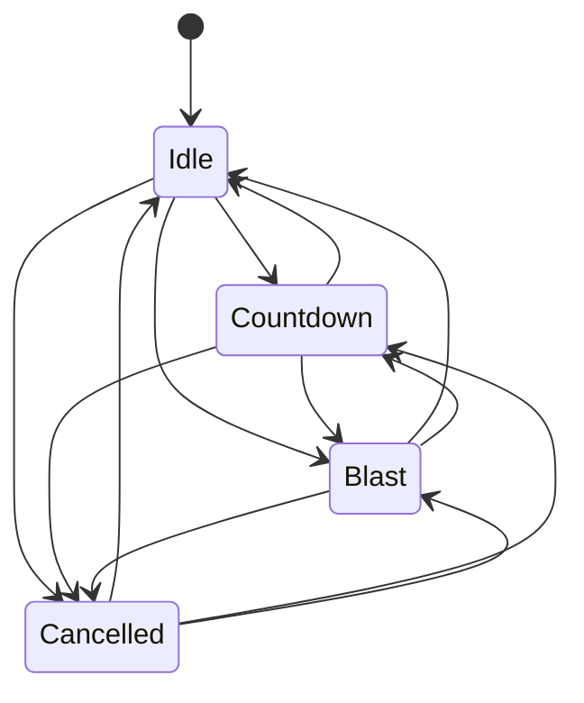
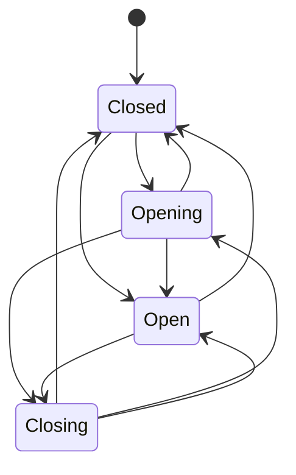

# State machines

Generated from the specs in `godot/ShooterCore/Fsm/StateMachineCatalog.cs` by `StateMachineCatalogTests`. Do not edit by hand: change the spec, then run
`UPDATE_STATE_DOCS=1 dotnet test godot/ShooterCore.Tests --filter StateMachineCatalogTests`.

How to add or change one: see `godot/ShooterCore/Fsm/StateMachine.cs`. `*` means "from any state".

## Hud.MoabBanner

The MOAB's top-centre banner: countdown, then the blast or the cancelled line.

- **Idle**: No panel. The countdown running out without a Blast event (the server's) also ends here.
- **Countdown**: Armed: the seconds left, rounded up, until detonation. Armed again restarts it; a banner still showing is replaced.
- **Blast**: Detonation: the owner's name for 3 s; the flash (0.6 s, none with reduce motion) runs on its own clock and may outlive a re-armed banner.
- **Cancelled**: The countdown was stopped: the line for 3 s.

## Hud.PanelFade

A full-screen overlay's open/close fade (Equipment screen, tactical map).

- **Closed**: Hidden and not processing; the first frame after Show makes it visible.
- **Opening**: Wanted open, alpha ramping up (the fade is 150 ms, none with reduce motion).
- **Open**: Wanted open at full alpha. Reduce motion jumps Closed -> Open and Open -> Closed.
- **Closing**: Not wanted, alpha ramping down; Show during it turns back to Opening from the current alpha.

