# State machines

Generated from the specs in `godot/ShooterCore/Fsm/StateMachineCatalog.cs` by `StateMachineCatalogTests`. Do not edit by hand: change the spec, then run
`UPDATE_STATE_DOCS=1 dotnet test godot/ShooterCore.Tests --filter StateMachineCatalogTests`.

How to add or change one: see `godot/ShooterCore/Fsm/StateMachine.cs`. "From any state" lines list the transitions that need no edge.

## Animal.Behaviour

What an animal is doing: stand, eat, wander, sit, bark, run from a threat or a shot, lie dead until the corpse is removed.

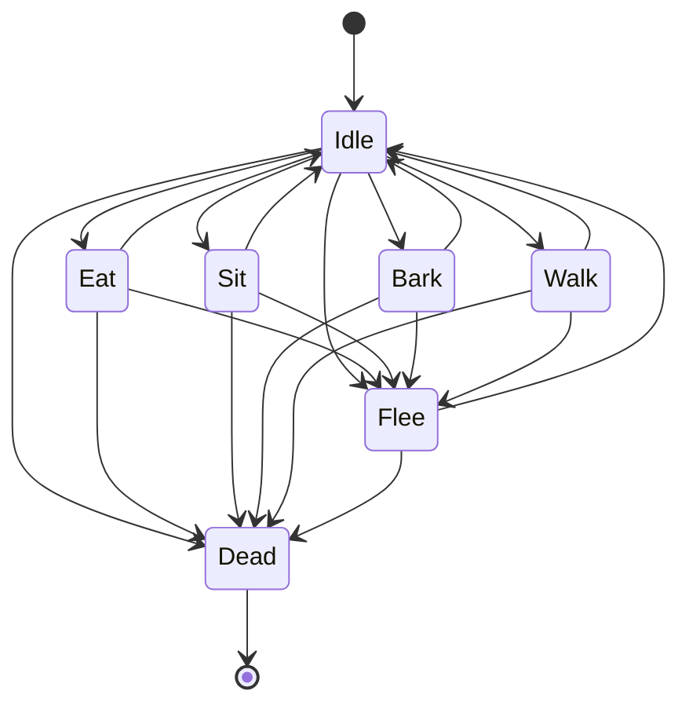

- **Idle**: Stands for a random while (clock: idle seconds), then Choose: sit or bark (species that opt in), eat, or walk to a spot near home.
- **Eat**: Grazes (clock: eat seconds), then stands.
- **Walk**: Walks to a wander target (clock: the time budget to arrive, then it gives up and stands).
- **Flee**: Runs from the threat or the shooter; no clock of its own (calm and alarm timers run beside). Calms down into Idle.
- **Dead**: Lies for corpse_seconds (the clock's elapsed time), then the entity ends; a one-hit species' entity ends at once. Never left.
- **Sit**: Sits for a random while (clock: sit seconds; the client plays sit-down, holds, stands up after), then stands. Species with a sit rule only.
- **Bark**: Barks once (clock: the bark clip's length), then stands. Species with a bark rule only.

## App.Phase

Boot, menus, loading, a running match; the one value the shooter's entry point and menu shell hang their behaviour on.

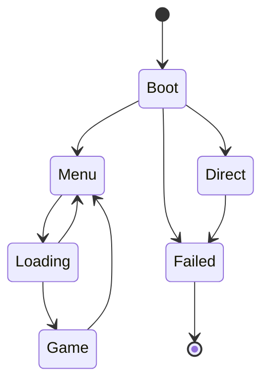

- **Boot**: Menu: client with a display and no smoke or script flags. Direct: server, offline, smoke, bot roles. Failed: startup threw.
- **Menu**: Entered again after a cancelled or failed join (connect screen with the reason) and after leaving or losing a match (toast).
- **Loading**: Left for Game when the server welcomes us; back to Menu when cancelled, failed, or the connection dropped meanwhile.
- **Game**: Left only for Menu: Disconnect from Pause, or the server dropped us.
- **Direct**: No menus; ends with the process, or Failed when loading the data or map threw.
- **Failed**: Terminal: Quit(2) was requested.

## Bigfoot.Act

What the Bigfoot is doing this moment: chasing, winding up or landing one attack, or holding a player; it ends dead.

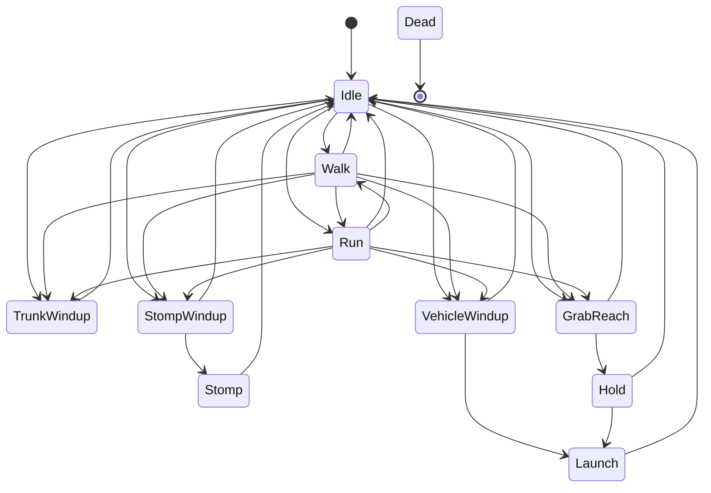

From any state: Dead

- **Idle**: Standing: nobody in reach, a stop distance reached, or waiting after a wipe. Every ended act comes back here.
- **TrunkWindup**: Log on the shoulder, turning to its target; the log flies when the wind-up ends (back to Idle).
- **StompWindup**: The telegraph; the shockwave starts when it ends. A wipe may cut it short.
- **Stomp**: The shockwave runs (BigfootRules.StompSeconds of pose).
- **VehicleWindup**: The vehicle is lifted overhead; it is thrown when the wind-up ends. A wipe or death drops it.
- **GrabReach**: Reaching for the nearest player on foot; holds them if still in reach, else back to Idle.
- **Hold**: Holds one player in its hand until the hold time runs out (launch) or the player dies or leaves (Idle).
- **Launch**: The short swing after a throw or a launch.
- **Dead**: Reachable from every act (a killing hit, or an admin ending the event).

## Bigfoot.Event

The server's Bigfoot event: none, a living Bigfoot, or the dead one lying out its death clip before it becomes the reward.

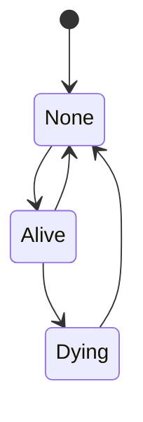

- **Dying**: The event is already won (the book has no running event) but a new Bigfoot may not start until the body is gone.

## Bigfoot.Life

Fighting, healed and waiting after a wipe, or dead.

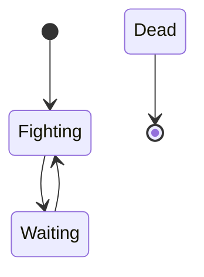

From any state: Dead

- **Waiting**: Wiped: healed to full, standing where it was, until a living player comes within the wake radius or a shot lands.
- **Dead**: Reachable from Fighting and Waiting (a shot can also kill a waiting one).

## Bigfoot.VehicleThrow

A vehicle the Bigfoot throws: lifted overhead, held until it is thrown (or put down), flying its scripted arc, landed.

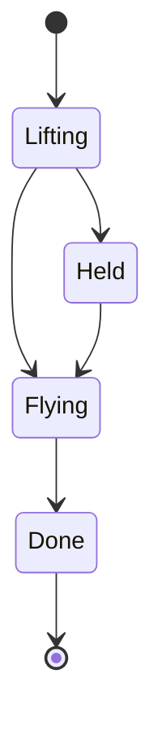

- **Held**: Overhead and still; one nobody throws is put down after a grace time (the Bigfoot died or was wiped with it up there).
- **Flying**: Also the put-down: the arc back to where it stood.

## Breath.Phase

Sniper breath hold: ready, holding (steady aim, the meter drains), forced exhale (heavy sway, cannot hold).

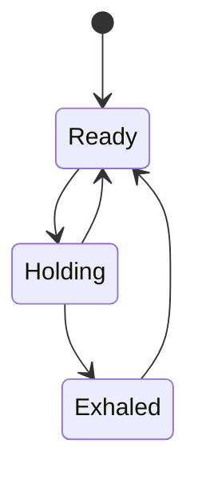

- **Ready**: Not holding: the meter refills. Also the phase whenever the weapon is not scoped or has no breath hold.
- **Holding**: The breath key is down, scoped, meter above 0 and not latched by a forced exhale: sway x0.3, the meter drains.
- **Exhaled**: The meter ran out: sway x2.5 for breath_recover_seconds, the breath cannot be held; the key must be released before the next hold.

## Citizen.State

What a citizen of the Holy Mass is doing; the replicated state byte.

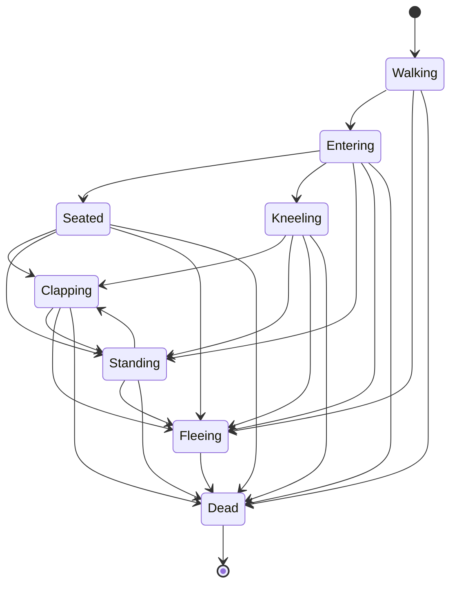

- **Walking**: On the navigation-mesh route from the house to the church door.
- **Entering**: On the scripted route inside the church to the seat.
- **Seated**: In a pew (a citizen) or at a desk (an Urad worker, spawned in place); the client plays the sit pose.
- **Dead**: Lies where it fell: a citizen's body is removed after the corpse time, the pastor's, a monk's and an Urad worker's lie until the event is cleared or the detour ends. Any hit kills in one.
- **Kneeling**: At a standing spot (a citizen).
- **Standing**: The pastor or a monk at their spot, or a citizen on its feet after the Mass.
- **Clapping**: The Mass is done and the body cheers (the pastor flexes).
- **Fleeing**: Sprinting home because the demon came; ends in removal at the spawn point (the entity ends, no state follows).

## Demon.Phase

The demon's mind (Holy Mass): rests on an anchor, and from there roars, leaps, breathes fire, throws a fireball, pounces or crawls; a wipe sends it back to waiting, hits kill it.

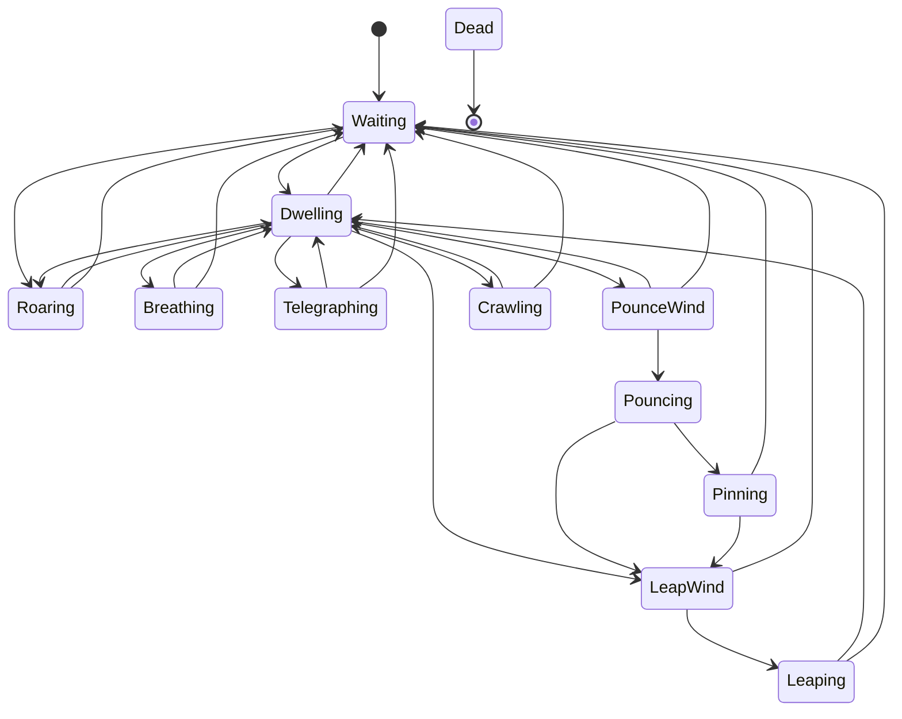

From any state: Dead

- **Waiting**: Still at its anchor: nobody has come in yet, or a wipe happened and the rearm delay is not over. A wipe in a crawl, leap or pounce lets that finish first (it waits where it gets to).
- **Dwelling**: Resting on an anchor facing its target: picks the next move when the dwell runs out (a due leap, flame and fireball come first).
- **Telegraphing**: The wind-up of a fireball; the telegraph event warns the clients. Back to Dwelling with the dwell it had.
- **Roaring**: Stopped on its anchor, roaring: when it wakes (if the data says so), at a health share, or on the roar clock.
- **LeapWind**: Crouched before a leap; also the crouch of the leap away that ends every pounce.
- **PounceWind**: Crouched and facing its victim, who is marked. Aborts (to Dwelling or Waiting) when the victim is gone.
- **Pouncing**: A homing arc to the victim's feet. Lands as Pinning, or, when the victim is gone, leaps away (LeapWind).
- **Pinning**: Standing over the pinned victim for the pin time, then leaps away. A wipe here leaves it standing on the floor until the rearm delay is over.
- **Dead**: Hits reached the hits needed. Final: a dead demon ignores hits and steps; Reset starts a new one.

## Demon.Pounce

The victim of a pounce: marked in the crouch (Wind), held on landing (Pinned), then let go as Released after the pin or Aborted when they leave or die, or the demon dies or is wiped.

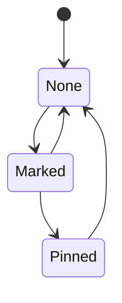

- **None**: Nobody marked. Every way back here sets the pounce cooldown and remembers the victim (never the same one twice while another qualifies).
- **Marked**: The victim is marked from the crouch to the landing; the host holds them back from health changes. Gone before the landing: Aborted, the demon finishes its leap with nobody pinned.
- **Pinned**: Lying flat on the floor under the demon. Pin time over: Released (the host sets their health). Gone, or the demon dies: Aborted.

## Demon.Stage

The server's script around the demon brain: the pastor turns, burns into the demon, climbs the wall, fights, dies; anything can end it early.

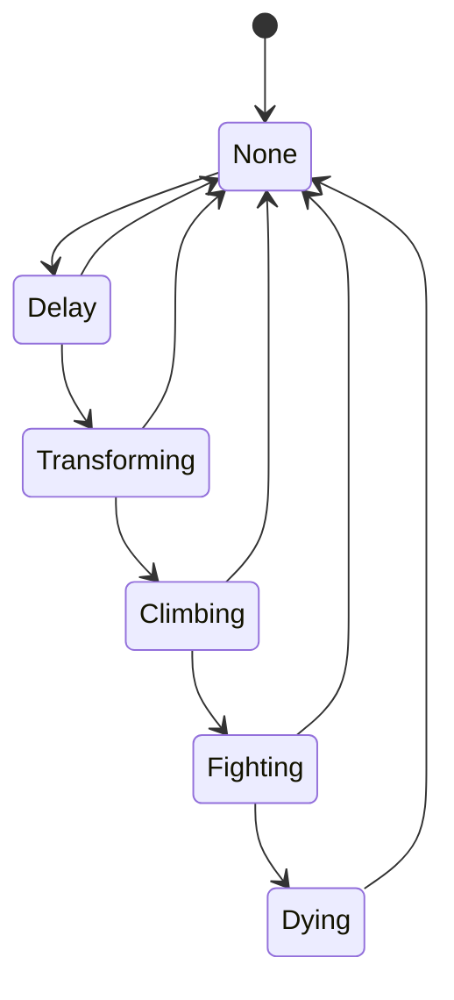

- **None**: No demon: the Mass is not void or the fight is cleared. Nothing ticks.
- **Delay**: The pastor has turned; his body still lies there for transform_delay_s. A failed spawn (entity cap) clears from here: the doors must still open.
- **Transforming**: The pastor's body is gone, the monks burn, the demon entity exists and cannot be hit (transform_s).
- **Climbing**: Scripted leap from the floor to the first anchor (climb_s); the entity is replicated as Crawling. Not yet hittable.
- **Fighting**: The DemonBrain runs; the demon is a hit target. Ends by its death (a weapon hit) or by a clear.
- **Dying**: The corpse lies for corpse_s; fireballs in the air still fly. Then the server ends the Mass.

## Demon.Wake

Whether the demon fights: it sleeps from the start of an event and after a wipe, wakes when a player is inside and the rearm delay is over.

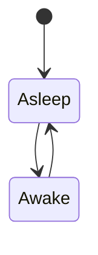

- **Asleep**: Resting phases show as Waiting; the health is back to full and the pounce, flame and leap clocks are cleared.
- **Awake**: Fighting: the hits needed grow with the players inside and never shrink; the fight clock, the roar clock and the leap clock run.

## Event.Run

One run of an event: active, then won (reward given) or despawned (no reward). Both ends are final.

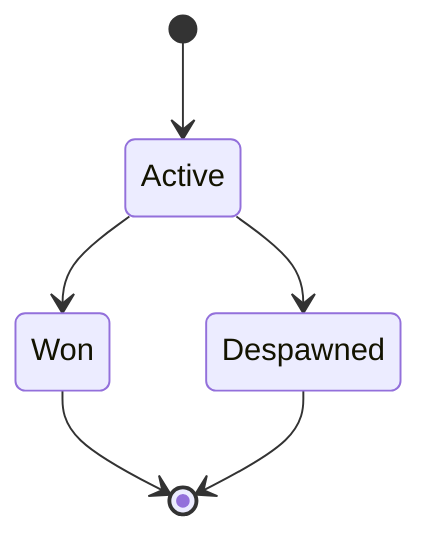

- **Won**: Concluded: the reward is due.
- **Despawned**: Timed out, cancelled or cleared by a round: no reward.

## GangMember.State

What a Gang member of a Raid is doing; the replicated state byte.

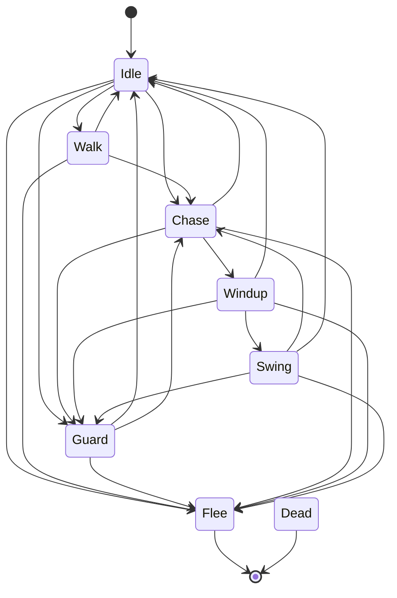

From any state: Dead

- **Idle**: A Thief standing (clock: a random time, then it walks to a point near the post). Steals nothing until ticket 04.
- **Walk**: A Thief on a route to a point near the post (clock: the time budget to arrive, then it stands again).
- **Guard**: An Enforcer follows the Thief it escorts, or stands at the post; the Gang boss stands at the post. Never steals.
- **Chase**: Runs at the player the Raid is fighting (a route from the navigation mesh, asked for at most every repath_seconds); winds up once within reach.
- **Windup**: The swing's telegraph (clock: windup_seconds): a player can step out of reach. Ends in Swing, or in a stand if the target is gone.
- **Swing**: The blow lands at its start, only if the target is still within reach; then recovers (clock: interval minus windup) and chases or stands again.
- **Flee**: Runs for the map edge on a route (clock: flee_seconds); the entity ends there (no state follows).
- **Dead**: Lies for corpse_seconds (the clock's elapsed time), then the entity ends. Reached from any state; never left.

## HelicopterGunner.Phase

The helicopter's gun cycle: wait, warn the picked enemy, fire a burst, wait again.

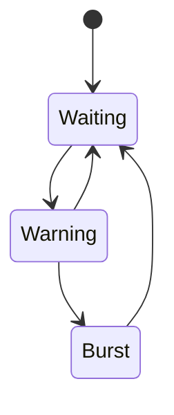

- **Waiting**: Counting down the cycle gap; at zero it picks the best visible enemy (none: waits another gap). No target.
- **Warning**: The target has its red-dot warning; at zero the burst starts if it is still visible, else back to Waiting.
- **Burst**: One round each round interval while the target stays visible; the last round or a lost target goes back to Waiting.

## Hud.MoabBanner

The MOAB's top-centre banner: countdown, then the blast or the cancelled line.

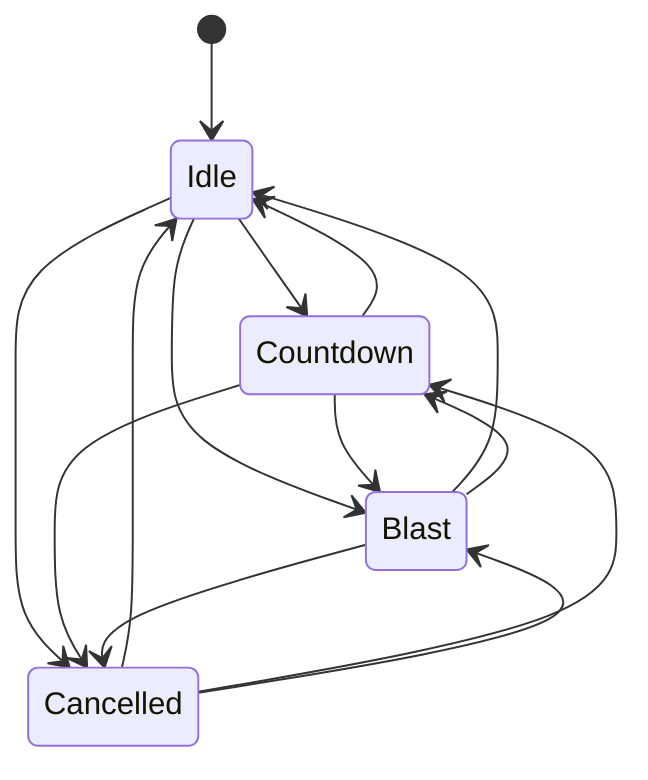

- **Idle**: No panel. The countdown running out without a Blast event (the server's) also ends here.
- **Countdown**: Armed: the seconds left, rounded up, until detonation. Armed again restarts it; a banner still showing is replaced.
- **Blast**: Detonation: the owner's name for 3 s; the flash (0.6 s, none with reduce motion) runs on its own clock and may outlive a re-armed banner.
- **Cancelled**: The countdown was stopped: the line for 3 s.

## Hud.PanelFade

A full-screen overlay's open/close fade (Equipment screen, tactical map).

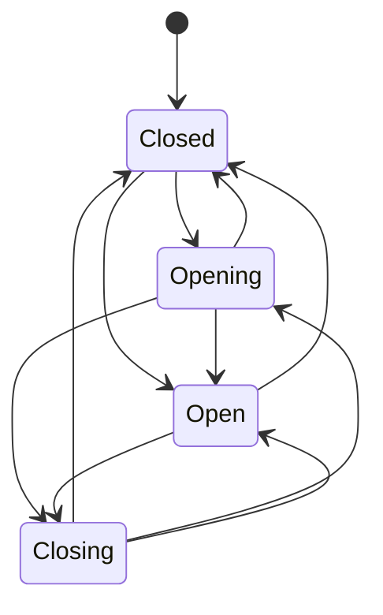

- **Closed**: Hidden and not processing; the first frame after Show makes it visible.
- **Opening**: Wanted open, alpha ramping up (the fade is 150 ms, none with reduce motion).
- **Open**: Wanted open at full alpha. Reduce motion jumps Closed -> Open and Open -> Closed.
- **Closing**: Not wanted, alpha ramping down; Show during it turns back to Opening from the current alpha.

## Killstreak.Hold

One loadout streak in one life: kills to go, earned and held, used.

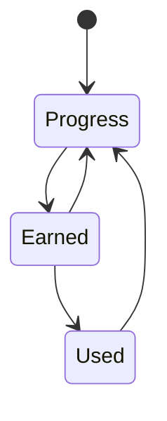

- **Progress**: Not earned: the Streak counter is below the threshold (the start of every life).
- **Earned**: Threshold reached (StreakEarned sent): held until the owner uses it.
- **Used**: Activation accepted (StreakUsed sent): spent for this life, whether it still runs or has ended. Only a death or a round reset brings it back to Progress.

## Killstreak.Slot

A loadout streak slot on the HUD tracker: kills to go, ready to use, running, spent for this life.

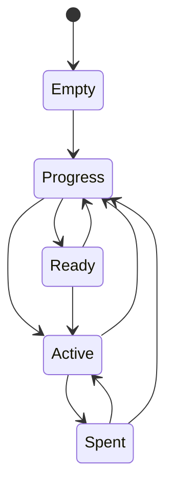

- **Empty**: No streak (or an unknown id) in the slot; set by Arm, never left except by the next Arm.
- **Progress**: Not earned: kills still to go. The state of every streak at the start of a life.
- **Ready**: Earned (StreakEarned) and held: the Killstreak key uses it.
- **Active**: Used (StreakUsed) and running until StreakEnded.
- **Spent**: Used and ended this life; it comes back only after a death or a round reset.

## Killstreak.Use

One activation of a killstreak: inside Activate, running, ended; or refused and dropped.

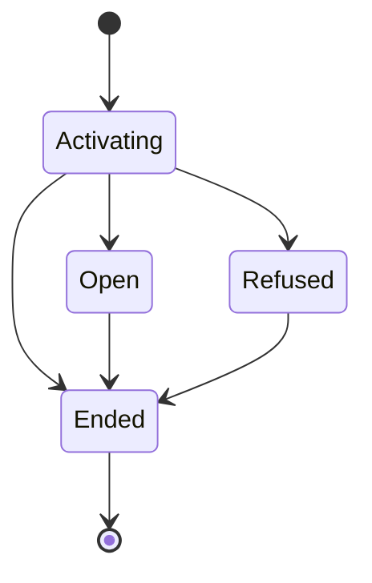

- **Activating**: The service called the implementation's Activate and has not heard back. A use that ends here is completed (event, callbacks) after Activate returns, once StreakUsed went out.
- **Open**: Accepted and running until its duration, its own End, its owner's death or leaving, a round reset, or its aircraft's destruction.
- **Refused**: Activate returned false: dropped by the service, the streak stays held. Never ended by the framework.
- **Ended**: Over: EndReason is set, StreakEnded sent, callbacks run.

## Loadout.Autosave

One loadout slot's save: debounce, one send on the wire, ack or retry with backoff; an explicit rejection stops the retries.

```mermaid
stateDiagram-v2
    [*] --> Saved
    Saved --> Pending
    Pending --> Saving
    Saving --> Saved
    Saving --> Pending
    Saving --> Rejected
    Saving --> Retrying
    Retrying --> Saving
    Rejected --> Pending
```

- **Saved**: Nothing unsent or in flight; no draft.
- **Pending**: Draft waiting for its quiet period (or for the answer to an older send) before it goes out.
- **Saving**: One save for the slot is on the wire. An edit meanwhile only marks the draft newer; it goes after the answer.
- **Retrying**: The send failed (timeout, no connection): resent with backoff. An edit meanwhile keeps the backoff clock and rides the next try.
- **Rejected**: The server refused the draft: shown with its reason, kept, never resent until the next edit or undo.

## Mass.Pastor

Whether the pastor stands ready, so the Mass progresses, or a killed one is being replaced.

```mermaid
stateDiagram-v2
    [*] --> Off
    Off --> Ready
    Off --> Gone
    Ready --> Gone
    Ready --> Off
    Gone --> Arriving
    Gone --> Off
    Arriving --> Settling
    Arriving --> Gone
    Arriving --> Off
    Settling --> Ready
    Settling --> Gone
    Settling --> Off
```

- **Off**: Not tracked: no event, or the Mass is over or void (the pastor no longer pauses anything).
- **Ready**: He stands at his spot and the pause after a kill is over: the chant plays.
- **Gone**: Killed (or the first spawn was refused): a new one walks out after PastorReplaceSeconds; a refused spawn retries every second.
- **Arriving**: The replacement walks from the sacristy door to the pastor's spot.
- **Settling**: He stands at his spot; the Mass resumes after ResumeSeconds.

## Mass.Phase

The Holy Mass event timeline: gather, Mass, done or void.

```mermaid
stateDiagram-v2
    [*] --> Idle
    Idle --> Gather
    Idle --> Void
    Gather --> Mass
    Gather --> Completed
    Gather --> Void
    Gather --> Idle
    Mass --> Completed
    Mass --> Void
    Mass --> Idle
    Completed --> Void
    Completed --> Idle
    Void --> Idle
```

- **Idle**: No event. Start begins the gather; an admin ForceTurn from here starts one that is void at once.
- **Gather**: The bells ring, citizens walk in and sit. Ends when everyone is in place (StartDelaySeconds) or when the gather timer runs out, whichever comes first; Conclude skips to Completed.
- **Mass**: The chant runs; progress counts only while the pastor is ready. Ends at MassSeconds of progress, or by Conclude.
- **Completed**: The blessed are chosen, citizens stand and clap, the pastor flexes. Lingers CompletedSeconds, then the event ends. An admin ForceTurn can still void it.
- **Void**: The pastor turned (third kill or ForceTurn): the demon's cue, citizens sprint home, no blessing. Stays until End or Conclude.

## Mass.Seat

What a player is told about the Holy Mass seats: nothing, a free seat in reach, or sitting.

```mermaid
stateDiagram-v2
    [*] --> None
    None --> CanSit
    None --> Seated
    CanSit --> None
    CanSit --> Seated
    Seated --> None
```

- **None**: No seat in reach, not in the event, or just stood up.
- **CanSit**: A free seat is in reach: the client shows the sit prompt.
- **Seated**: Sitting: the server holds the body, the client does not predict it. Interact or jump stands up; death, a car, the end of the Mass and the blessing end it too.

## Match.Phase

The match loop: waiting for players, a running round, the end screen.

```mermaid
stateDiagram-v2
    [*] --> Waiting
    Waiting --> Running
    Running --> Ending
    Running --> Waiting
    Ending --> Running
    Ending --> Waiting
```

- **Waiting**: Fewer than MinPlayers (nobody, in the shipped match.json). Scores and lives are reset; the next join or restart starts a round.
- **Running**: Time limit counts down from the round start. Left by the time limit or score goal (Ending), too few players (Waiting). An admin restart re-enters it with a fresh round.
- **Ending**: End screen for EndScreenTime; hits are ignored. Then a new round starts by itself.

## Match.PlayerLife

Whether a player is in the world: unspawned, alive or dead awaiting the respawn.

```mermaid
stateDiagram-v2
    [*] --> Unspawned
    Unspawned --> Alive
    Alive --> Dead
    Alive --> Unspawned
    Dead --> Alive
    Dead --> Unspawned
```

- **Unspawned**: Not in the world: before the first spawn, or between a round reset and the spawn that follows it. Hits are ignored.
- **Alive**: In the world with health. Spawn protection (ProtectedUntil), a blessing's invulnerability and the demon's hold are timers beside this state.
- **Dead**: Awaiting RespawnAt (the respawn delay after the lethal hit).

## Menu.Connect

The connect screen: edit the target, probe it with a visible timeout, show what went wrong.

```mermaid
stateDiagram-v2
    [*] --> Form
    Form --> Connecting
    Form --> Error
    Connecting --> Form
    Connecting --> Error
    Error --> Form
    Error --> Connecting
```

- **Form**: Fields editable. Connect is enabled only for a valid form. A failed join or lost connection reopens the screen as Error instead.
- **Connecting**: Probe running; its sockets are released when this state ends, however it ends. Success hands over to loading (the screen is replaced).
- **Error**: Probe failed (timeout, refused, unresolvable, local socket) or the last join failed. Try again goes straight back to Connecting.

## Moab.Phase

A MOAB from call-in to blast: counting down, then detonated or cancelled.

```mermaid
stateDiagram-v2
    [*] --> Armed
    Armed --> Detonated
    Armed --> Cancelled
    Detonated --> [*]
    Cancelled --> [*]
```

- **Armed**: Called in: the countdown (the streak's duration) runs; only one is pending per match.
- **Detonated**: The countdown ran out (the use ended as Expired): everyone but the owner dies, vehicles blow up.
- **Cancelled**: The use ended any other way: owner died or left, round reset, or a sandbox owner used it again (Replaced; the new one's Armed follows at once). No blast.

## Pounce.View

The client's view of the demon's pounce: a victim is marked (Wind), pinned flat, then let go; the local victim's camera rises back afterwards.

```mermaid
stateDiagram-v2
    [*] --> None
    None --> Wind
    None --> Pinned
    Wind --> Pinned
    Wind --> None
    Pinned --> Rising
    Pinned --> None
    Pinned --> Wind
    Rising --> None
    Rising --> Wind
    Rising --> Pinned
```

- **None**: Nobody is marked or held (also after the demon is gone).
- **Wind**: A victim is marked: the local victim's look is locked on the demon. A joiner can start here.
- **Pinned**: The victim lies pinned. Locally: the body is the server's (no prediction, no weapon), the camera is on the floor. A joiner can start here.
- **Rising**: The local victim was let go: the camera rises back to standing height while the red fades. Only after a pin of the local player.

## Rozhlas.Phase

The village loudspeaker: a detour broadcast, and the hijack after the announcer is killed.

```mermaid
stateDiagram-v2
    [*] --> Idle
    Idle --> OnAir
    OnAir --> Idle
    OnAir --> Hijacked
    Hijacked --> Idle
```

- **Idle**: Nothing runs; the Urad is sealed. A scheduled slot (every PeriodS) or an admin's /event rozhlas starts a broadcast.
- **OnAir**: A detour broadcast plays for the length of its recording (the Urad is open, the mic is live). Ends by itself, or on AnnouncerKilled.
- **Hijacked**: The announcer was killed: the announcement is cut and the mic stays live for exactly HijackSeconds from the kill. One per broadcast, never refreshed.

## Rozhlas.Set

Who holds the rozhlas set (the mic at the dictation table): nobody, or one player while the mic is hijacked.

```mermaid
stateDiagram-v2
    [*] --> Free
    Free --> Held
    Held --> Free
```

- **Free**: Nobody is on the mic. A player may take it, only while the loudspeaker is Hijacked.
- **Held**: One player holds it (Holder). Released by their death, disconnect, hijack end, entering a vehicle, walking more than 2 m from the table (once it exists) or an explicit release.

## RozhlasFeed.Jitter

The client's jitter buffer for the live feed: wait for ~100 ms of frames, play them out, wait again after running dry.

```mermaid
stateDiagram-v2
    [*] --> Priming
    Priming --> Playing
    Playing --> Priming
```

- **Priming**: Frames are collected; nothing plays until the target depth is reached.
- **Playing**: One frame per 20 ms in sequence order; a missing one is concealed, a late one dropped; an empty buffer goes back to Priming.

## RozhlasFeed.Session

Whether the live feed (ffmpeg subprocess, 2 s delay line) is running for a mic-live phase.

```mermaid
stateDiagram-v2
    [*] --> Idle
    Idle --> Live
    Idle --> Failed
    Live --> Draining
    Live --> Failed
    Draining --> Idle
    Draining --> Live
    Draining --> Failed
    Failed --> Idle
    Failed --> Live
```

- **Idle**: No process. Nothing is sent.
- **Live**: Start() ran: input is accepted and pulled at a steady 50 blocks/s into ffmpeg; the degraded output goes out 2 s after its input.
- **Draining**: Stop() ran: no new input; what was written still plays out, then the echo tail, then ffmpeg ends. A Start() here cuts the tail short.
- **Failed**: ffmpeg missing, died, or stopped producing audio: logged once, the feed is silent until the next phase. Never unprocessed audio.

## Target.Dummy

A target dummy: standing, or down until it respawns.

```mermaid
stateDiagram-v2
    [*] --> Standing
    Standing --> Down
    Down --> Standing
```

- **Standing**: Hits register. Killed by the hit that takes its health to zero.
- **Down**: Ignores hits until RespawnAt (the match clock), unless Respawns is off (sandbox): then until the round restarts.

## Thieves.Phase

The Thieves event: idle until started, raiding while its Raids are in the village, then over until the round resets.

```mermaid
stateDiagram-v2
    [*] --> Idle
    Idle --> Raiding
    Raiding --> Over
    Raiding --> Idle
    Over --> Raiding
    Over --> Idle
```

- **Idle**: Nothing runs: never started, or a round reset cleared it.
- **Raiding**: The Raids come and go (clock: the placeholder timer until the Raids exist). Left by Finish (won or cancelled) or by a round reset.
- **Over**: Won or cancelled; what was stolen stays stolen. A new /event thieves starts it again, a round reset clears it.

## Turret.State

A sentry turret: the placing ghost, then armed and idle, acquiring a target (the outplay delay), or aiming and firing.

```mermaid
stateDiagram-v2
    [*] --> Placing
    Placing --> Idle
    Idle --> Acquiring
    Idle --> Aiming
    Acquiring --> Aiming
    Acquiring --> Idle
    Aiming --> Acquiring
    Aiming --> Idle
```

- **Placing**: A ghost that follows the owner's aim; Place arms it when the spot is valid. Only the owner sees it.
- **Idle**: Armed, no target: scans for enemies at the repick rate.
- **Acquiring**: Has a target and turns towards it, but holds fire for acquire_delay_s (the outplay window; the machine's clock). A different target restarts the delay.
- **Aiming**: Past the delay: turns, and shoots once within the aim tolerance and off cooldown. Idle again when the target is lost; Idle goes straight here when the delay is 0.

## Vehicle.Gun

A vehicle gun: ready to fire, or reloading.

```mermaid
stateDiagram-v2
    [*] --> Ready
    Ready --> Reloading
    Reloading --> Ready
```

- **Ready**: Fires one round per FireInterval while the trigger is held and the magazine has one.
- **Reloading**: No rounds until the reload time is over; the magazine is topped up from the reserve when it ends. The end is noticed by the next trigger update, not by a timer.

## Vehicle.Life

A server-side vehicle: alive, doomed (blast scheduled), destroyed until it returns.

```mermaid
stateDiagram-v2
    [*] --> Alive
    Alive --> Doomed
    Doomed --> Destroyed
    Doomed --> Alive
    Destroyed --> Alive
```

- **Alive**: Hit points above zero. A return that does not repair (abandoned, out of the world) keeps a damaged vehicle damaged.
- **Doomed**: Hit points are zero and DetonateAt is set: the blast goes off when the clock reaches it (the chain delay after a neighbour's blast, else this tick). A return repairs it.
- **Destroyed**: Blown up, no collision, nobody aboard. ReturnAt is set; the return repairs it and puts it back at its origin.

