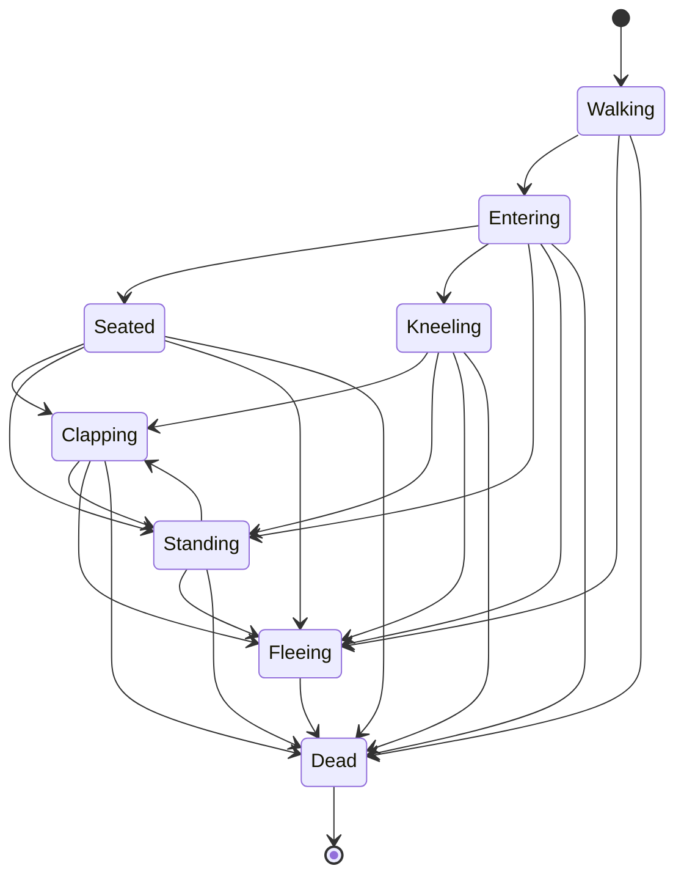
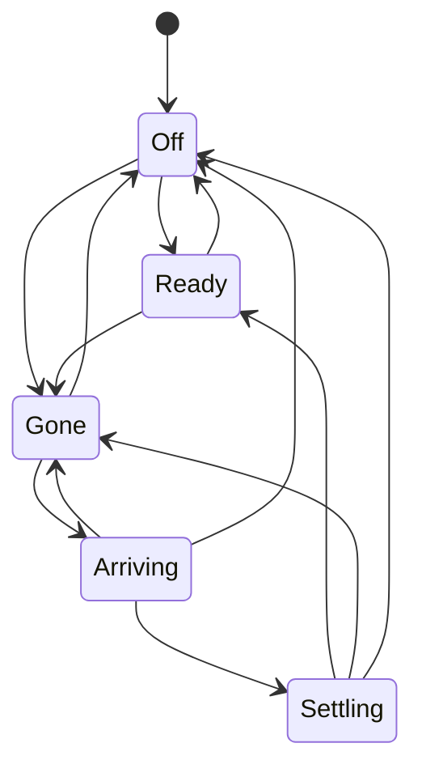
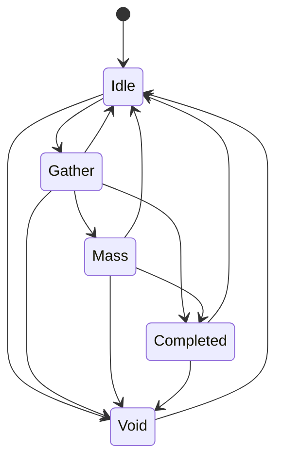
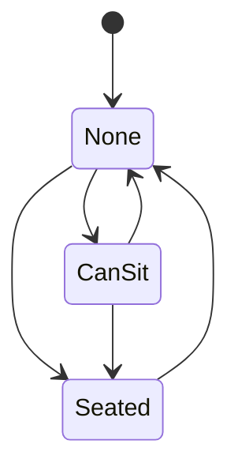

# State machines

Generated from the specs in `godot/ShooterCore/Fsm/StateMachineCatalog.cs` by `StateMachineCatalogTests`. Do not edit by hand: change the spec, then run
`UPDATE_STATE_DOCS=1 dotnet test godot/ShooterCore.Tests --filter StateMachineCatalogTests`.

How to add or change one: see `godot/ShooterCore/Fsm/StateMachine.cs`. `*` means "from any state".

## Citizen.State

What a citizen of the Holy Mass is doing; the replicated state byte.

- **Walking**: On the navigation-mesh route from the house to the church door.
- **Entering**: On the scripted route inside the church to the seat.
- **Seated**: In a pew (a citizen; the client plays the sit pose).
- **Dead**: Lies where it fell: a citizen's body is removed after the corpse time, the pastor's and a monk's lie until the event is cleared. Any hit kills in one.
- **Kneeling**: At a standing spot (a citizen).
- **Standing**: The pastor or a monk at their spot, or a citizen on its feet after the Mass.
- **Clapping**: The Mass is done and the body cheers (the pastor flexes).
- **Fleeing**: Sprinting home because the demon came; ends in removal at the spawn point (the entity ends, no state follows).

## Mass.Pastor

Whether the pastor stands ready, so the Mass progresses, or a killed one is being replaced.

- **Off**: Not tracked: no event, or the Mass is over or void (the pastor no longer pauses anything).
- **Ready**: He stands at his spot and the pause after a kill is over: the chant plays.
- **Gone**: Killed (or the first spawn was refused): a new one walks out after PastorReplaceSeconds; a refused spawn retries every second.
- **Arriving**: The replacement walks from the sacristy door to the pastor's spot.
- **Settling**: He stands at his spot; the Mass resumes after ResumeSeconds.

## Mass.Phase

The Holy Mass event timeline: gather, Mass, done or void.

- **Idle**: No event. Start begins the gather; an admin ForceTurn from here starts one that is void at once.
- **Gather**: The bells ring, citizens walk in and sit. Ends when everyone is in place (StartDelaySeconds) or when the gather timer runs out, whichever comes first; Conclude skips to Completed.
- **Mass**: The chant runs; progress counts only while the pastor is ready. Ends at MassSeconds of progress, or by Conclude.
- **Completed**: The blessed are chosen, citizens stand and clap, the pastor flexes. Lingers CompletedSeconds, then the event ends. An admin ForceTurn can still void it.
- **Void**: The pastor turned (third kill or ForceTurn): the demon's cue, citizens sprint home, no blessing. Stays until End or Conclude.

## Mass.Seat

What a player is told about the Holy Mass seats: nothing, a free seat in reach, or sitting.

- **None**: No seat in reach, not in the event, or just stood up.
- **CanSit**: A free seat is in reach: the client shows the sit prompt.
- **Seated**: Sitting: the server holds the body, the client does not predict it. Interact or jump stands up; death, a car, the end of the Mass and the blessing end it too.

