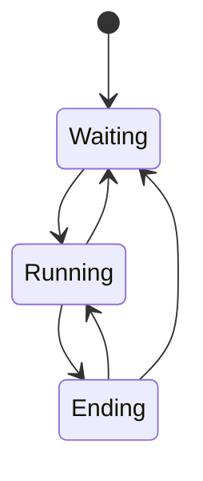
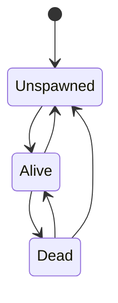
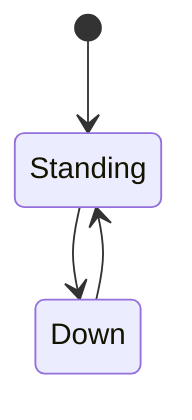
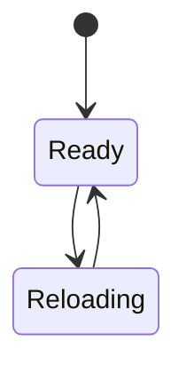
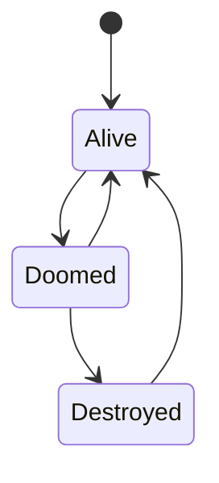

# State machines

Generated from the specs in `godot/ShooterCore/Fsm/StateMachineCatalog.cs` by `StateMachineCatalogTests`. Do not edit by hand: change the spec, then run
`UPDATE_STATE_DOCS=1 dotnet test godot/ShooterCore.Tests --filter StateMachineCatalogTests`.

How to add or change one: see `godot/ShooterCore/Fsm/StateMachine.cs`. `*` means "from any state".

## Match.Phase

The match loop: waiting for players, a running round, the end screen.

- **Waiting**: Fewer than MinPlayers (nobody, in the shipped match.json). Scores and lives are reset; the next join or restart starts a round.
- **Running**: Time limit counts down from the round start. Left by the time limit or score goal (Ending), too few players (Waiting). An admin restart re-enters it with a fresh round.
- **Ending**: End screen for EndScreenTime; hits are ignored. Then a new round starts by itself.

## Match.PlayerLife

Whether a player is in the world: unspawned, alive or dead awaiting the respawn.

- **Unspawned**: Not in the world: before the first spawn, or between a round reset and the spawn that follows it. Hits are ignored.
- **Alive**: In the world with health. Spawn protection (ProtectedUntil), a blessing's invulnerability and the demon's hold are timers beside this state.
- **Dead**: Awaiting RespawnAt (the respawn delay after the lethal hit).

## Target.Dummy

A target dummy: standing, or down until it respawns.

- **Standing**: Hits register. Killed by the hit that takes its health to zero.
- **Down**: Ignores hits until RespawnAt (the match clock), unless Respawns is off (sandbox): then until the round restarts.

## Vehicle.Gun

A vehicle gun: ready to fire, or reloading.

- **Ready**: Fires one round per FireInterval while the trigger is held and the magazine has one.
- **Reloading**: No rounds until the reload time is over; the magazine is topped up from the reserve when it ends. The end is noticed by the next trigger update, not by a timer.

## Vehicle.Life

A server-side vehicle: alive, doomed (blast scheduled), destroyed until it returns.

- **Alive**: Hit points above zero. A return that does not repair (abandoned, out of the world) keeps a damaged vehicle damaged.
- **Doomed**: Hit points are zero and DetonateAt is set: the blast goes off when the clock reaches it (the chain delay after a neighbour's blast, else this tick). A return repairs it.
- **Destroyed**: Blown up, no collision, nobody aboard. ReturnAt is set; the return repairs it and puts it back at its origin.

