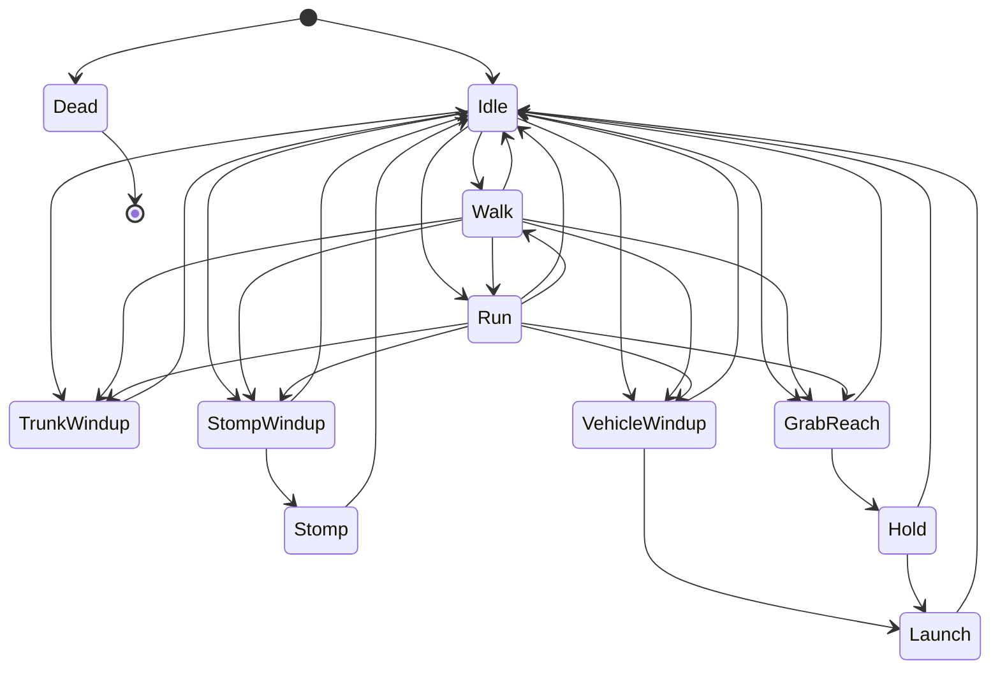
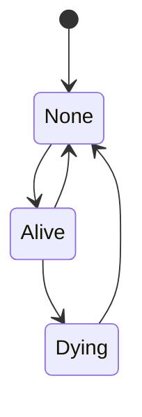
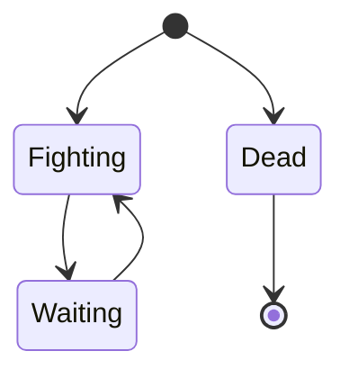
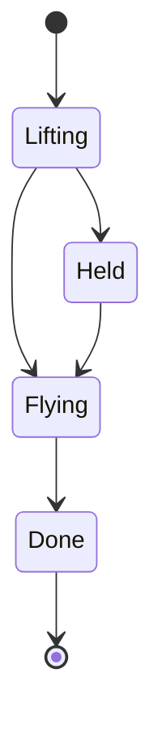
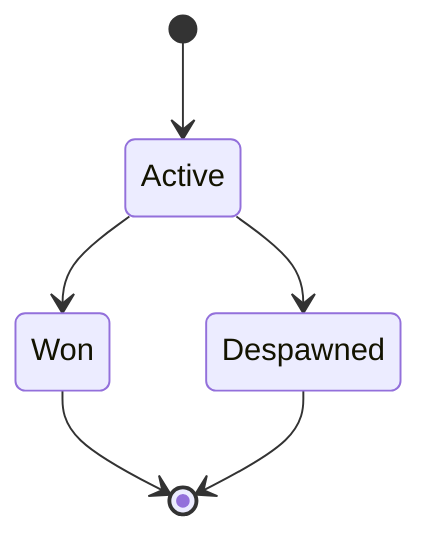

# State machines

Generated from the specs in `godot/ShooterCore/Fsm/StateMachineCatalog.cs` by `StateMachineCatalogTests`. Do not edit by hand: change the spec, then run
`UPDATE_STATE_DOCS=1 dotnet test godot/ShooterCore.Tests --filter StateMachineCatalogTests`.

How to add or change one: see `godot/ShooterCore/Fsm/StateMachine.cs`. `*` means "from any state".

## Bigfoot.Act

What the Bigfoot is doing this moment: chasing, winding up or landing one attack, or holding a player; it ends dead.

- **Idle**: Standing: nobody in reach, a stop distance reached, or waiting after a wipe. Every ended act comes back here.
- **TrunkWindup**: Log on the shoulder, turning to its target; the log flies when the wind-up ends (back to Idle).
- **StompWindup**: The telegraph; the shockwave starts when it ends. A wipe may cut it short.
- **Stomp**: The shockwave runs (BigfootRules.StompSeconds of pose).
- **VehicleWindup**: The vehicle is lifted overhead; it is thrown when the wind-up ends. A wipe or death drops it.
- **GrabReach**: Reaching for the nearest player on foot; holds them if still in reach, else back to Idle.
- **Hold**: Holds one player in its hand until the hold time runs out (launch) or the player dies or leaves (Idle).
- **Launch**: The short swing after a throw or a launch.
- **Dead**: Reachable from every act (a killing hit, or an admin ending the event).

## Bigfoot.Event

The server's Bigfoot event: none, a living Bigfoot, or the dead one lying out its death clip before it becomes the reward.

- **Dying**: The event is already won (the book has no running event) but a new Bigfoot may not start until the body is gone.

## Bigfoot.Life

Fighting, healed and waiting after a wipe, or dead.

- **Waiting**: Wiped: healed to full, standing where it was, until a living player comes within the wake radius or a shot lands.
- **Dead**: Reachable from Fighting and Waiting (a shot can also kill a waiting one).

## Bigfoot.VehicleThrow

A vehicle the Bigfoot throws: lifted overhead, held until it is thrown (or put down), flying its scripted arc, landed.

- **Held**: Overhead and still; one nobody throws is put down after a grace time (the Bigfoot died or was wiped with it up there).
- **Flying**: Also the put-down: the arc back to where it stood.

## Event.Run

One run of an event: active, then won (reward given) or despawned (no reward). Both ends are final.

- **Won**: Concluded: the reward is due.
- **Despawned**: Timed out, cancelled or cleared by a round: no reward.

