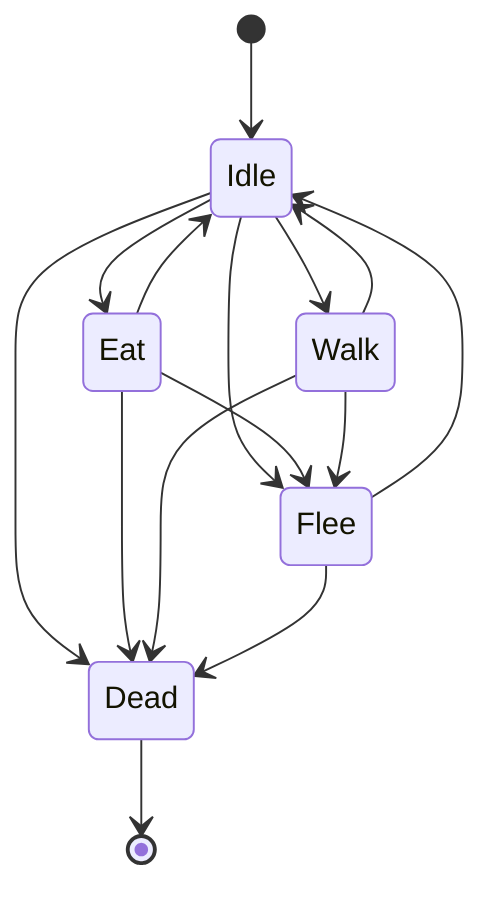
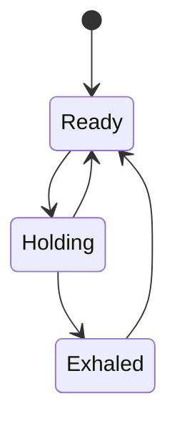
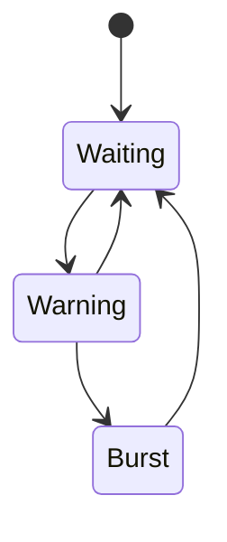
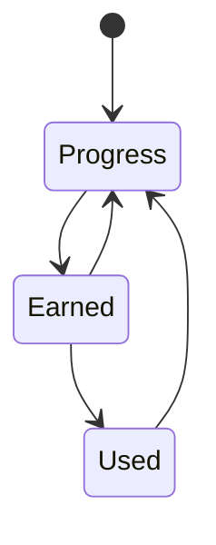
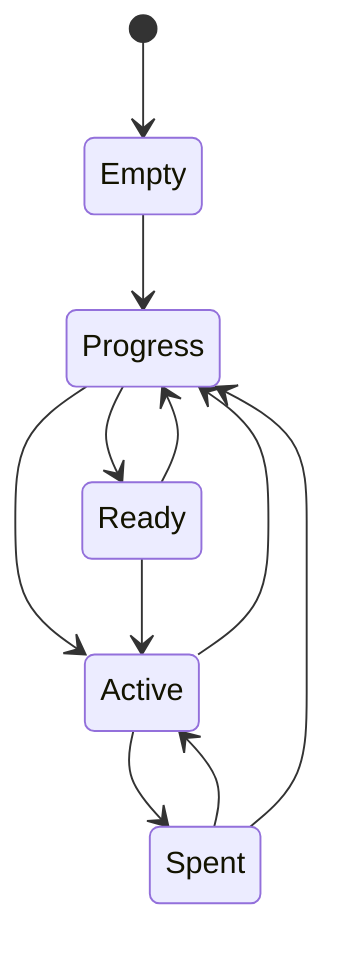
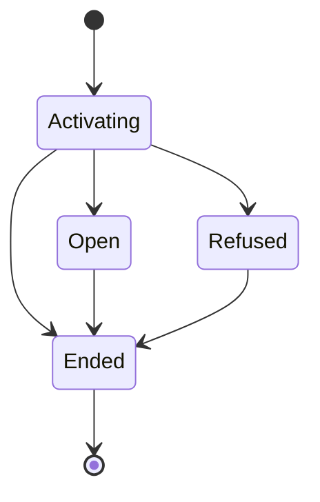
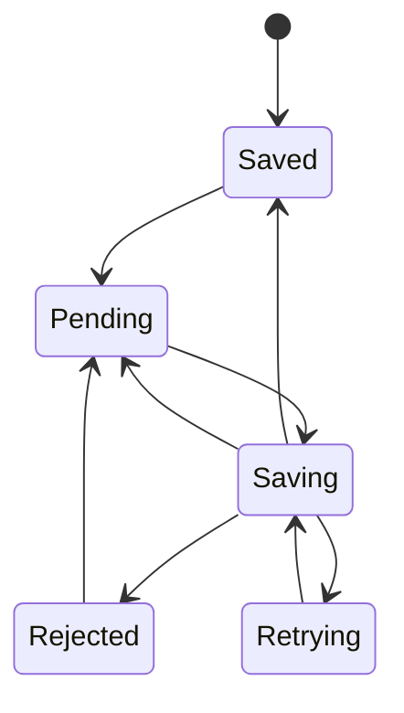
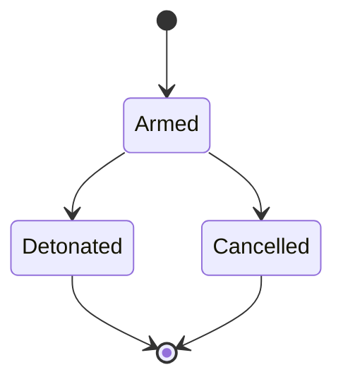
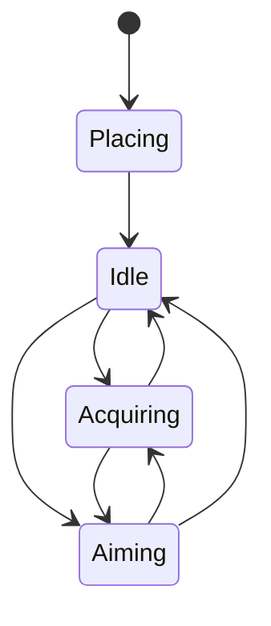

# State machines

Generated from the specs in `godot/ShooterCore/Fsm/StateMachineCatalog.cs` by `StateMachineCatalogTests`. Do not edit by hand: change the spec, then run
`UPDATE_STATE_DOCS=1 dotnet test godot/ShooterCore.Tests --filter StateMachineCatalogTests`.

How to add or change one: see `godot/ShooterCore/Fsm/StateMachine.cs`. `*` means "from any state".

## Animal.Behaviour

What an animal is doing: stand, eat, wander, run from a threat or a shot, lie dead until the corpse is removed.

- **Idle**: Stands for a random while (clock: idle seconds), then Choose: eat, or walk to a spot near home.
- **Eat**: Grazes (clock: eat seconds), then stands.
- **Walk**: Walks to a wander target (clock: the time budget to arrive, then it gives up and stands).
- **Flee**: Runs from the threat or the shooter; no clock of its own (calm and alarm timers run beside). Calms down into Idle.
- **Dead**: Lies for corpse_seconds (the clock's elapsed time), then the entity ends. Never left.

## Breath.Phase

Sniper breath hold: ready, holding (steady aim, the meter drains), forced exhale (heavy sway, cannot hold).

- **Ready**: Not holding: the meter refills. Also the phase whenever the weapon is not scoped or has no breath hold.
- **Holding**: The breath key is down, scoped, meter above 0 and not latched by a forced exhale: sway x0.3, the meter drains.
- **Exhaled**: The meter ran out: sway x2.5 for breath_recover_seconds, the breath cannot be held; the key must be released before the next hold.

## HelicopterGunner.Phase

The helicopter's gun cycle: wait, warn the picked enemy, fire a burst, wait again.

- **Waiting**: Counting down the cycle gap; at zero it picks the best visible enemy (none: waits another gap). No target.
- **Warning**: The target has its red-dot warning; at zero the burst starts if it is still visible, else back to Waiting.
- **Burst**: One round each round interval while the target stays visible; the last round or a lost target goes back to Waiting.

## Killstreak.Hold

One loadout streak in one life: kills to go, earned and held, used.

- **Progress**: Not earned: the Streak counter is below the threshold (the start of every life).
- **Earned**: Threshold reached (StreakEarned sent): held until the owner uses it.
- **Used**: Activation accepted (StreakUsed sent): spent for this life, whether it still runs or has ended. Only a death or a round reset brings it back to Progress.

## Killstreak.Slot

A loadout streak slot on the HUD tracker: kills to go, ready to use, running, spent for this life.

- **Empty**: No streak (or an unknown id) in the slot; set by Arm, never left except by the next Arm.
- **Progress**: Not earned: kills still to go. The state of every streak at the start of a life.
- **Ready**: Earned (StreakEarned) and held: the Killstreak key uses it.
- **Active**: Used (StreakUsed) and running until StreakEnded.
- **Spent**: Used and ended this life; it comes back only after a death or a round reset.

## Killstreak.Use

One activation of a killstreak: inside Activate, running, ended; or refused and dropped.

- **Activating**: The service called the implementation's Activate and has not heard back. A use that ends here is completed (event, callbacks) after Activate returns, once StreakUsed went out.
- **Open**: Accepted and running until its duration, its own End, its owner's death or leaving, a round reset, or its aircraft's destruction.
- **Refused**: Activate returned false: dropped by the service, the streak stays held. Never ended by the framework.
- **Ended**: Over: EndReason is set, StreakEnded sent, callbacks run.

## Loadout.Autosave

One loadout slot's save: debounce, one send on the wire, ack or retry with backoff; an explicit rejection stops the retries.

- **Saved**: Nothing unsent or in flight; no draft.
- **Pending**: Draft waiting for its quiet period (or for the answer to an older send) before it goes out.
- **Saving**: One save for the slot is on the wire. An edit meanwhile only marks the draft newer; it goes after the answer.
- **Retrying**: The send failed (timeout, no connection): resent with backoff. An edit meanwhile keeps the backoff clock and rides the next try.
- **Rejected**: The server refused the draft: shown with its reason, kept, never resent until the next edit or undo.

## Moab.Phase

A MOAB from call-in to blast: counting down, then detonated or cancelled.

- **Armed**: Called in: the countdown (the streak's duration) runs; only one is pending per match.
- **Detonated**: The countdown ran out (the use ended as Expired): everyone but the owner dies, vehicles blow up.
- **Cancelled**: The use ended any other way: owner died or left, round reset, or a sandbox owner used it again (Replaced; the new one's Armed follows at once). No blast.

## Turret.State

A sentry turret: the placing ghost, then armed and idle, acquiring a target (the outplay delay), or aiming and firing.

- **Placing**: A ghost that follows the owner's aim; Place arms it when the spot is valid. Only the owner sees it.
- **Idle**: Armed, no target: scans for enemies at the repick rate.
- **Acquiring**: Has a target and turns towards it, but holds fire for acquire_delay_s (the outplay window; the machine's clock). A different target restarts the delay.
- **Aiming**: Past the delay: turns, and shoots once within the aim tolerance and off cooldown. Idle again when the target is lost; Idle goes straight here when the delay is 0.

