# State machines

Generated from the specs in `godot/ShooterCore/Fsm/StateMachineCatalog.cs` by `StateMachineCatalogTests`. Do not edit by hand: change the spec, then run
`UPDATE_STATE_DOCS=1 dotnet test godot/ShooterCore.Tests --filter StateMachineCatalogTests`.

How to add or change one: see `godot/ShooterCore/Fsm/StateMachine.cs`. "From any state" lines list the transitions that need no edge.

## Animal.Behaviour

What an animal is doing: stand, eat, wander, sit, bark, run from a threat or a shot, lie dead until the corpse is removed.

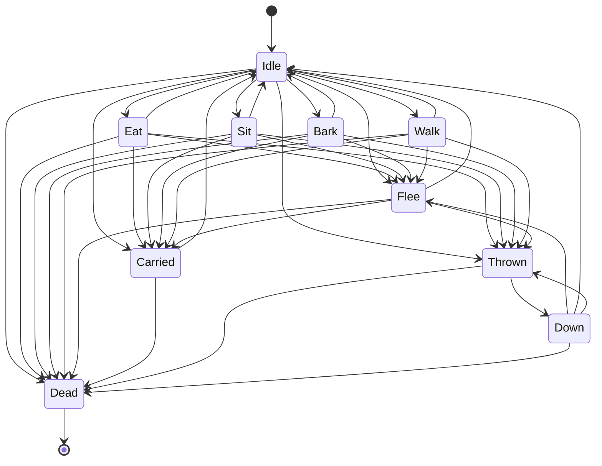

- **Idle**: Stands for a random while (clock: idle seconds), then Choose: sit or bark (species that opt in), eat, or walk to a spot near home.
- **Eat**: Grazes (clock: eat seconds), then stands.
- **Walk**: Walks to a wander target (clock: the time budget to arrive, then it gives up and stands).
- **Flee**: Runs from the threat or the shooter; no clock of its own (calm and alarm timers run beside). Calms down into Idle.
- **Dead**: A body a vehicle threw flies on first. Lies for corpse_seconds (the clock's elapsed time), then the entity ends; a one-hit species' entity ends at once. Never left.
- **Sit**: Sits for a random while (clock: sit seconds; the client plays sit-down, holds, stands up after), then stands. Species with a sit rule only.
- **Bark**: Barks once (clock: the bark clip's length), then stands. Species with a bark rule only.
- **Carried**: A Thief of the Thieves event holds it (no clock: it is moved by the Thief, MoveCarried, and does nothing itself). Let go (Release) it stands; one put down outside its Pen walks home over open ground until it is inside again. Still a hit target: any hit that deals damage kills it.
- **Thrown**: A vehicle ran it over and it survived (Throw): it flies on the arc the vehicle gave it, then rolls on along the ground with part of that speed; no clock. Coming to rest puts it Down. Still a hit target; another vehicle only changes the arc.
- **Down**: Lies knocked down where it landed (clock: knockdown_seconds), then gets up: Flee from where the vehicle was (a species that does not flee stands). Run over again it is Thrown again.

## App.Phase

Boot, menus, loading, a running match; the one value the shooter's entry point and menu shell hang their behaviour on.

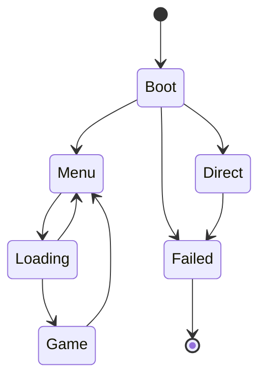

- **Boot**: Menu: client with a display and no smoke or script flags. Direct: server, offline, smoke, bot roles. Failed: startup threw.
- **Menu**: Entered again after a cancelled or failed join (connect screen with the reason) and after leaving or losing a match (toast).
- **Loading**: Left for Game when the server welcomes us; back to Menu when cancelled, failed, or the connection dropped meanwhile.
- **Game**: Left only for Menu: Disconnect from Pause, or the server dropped us.
- **Direct**: No menus; ends with the process, or Failed when loading the data or map threw.
- **Failed**: Terminal: Quit(2) was requested.

## Bigfoot.Act

What the Bigfoot is doing this moment: chasing, winding up or landing one attack, or holding a player; it ends dead.

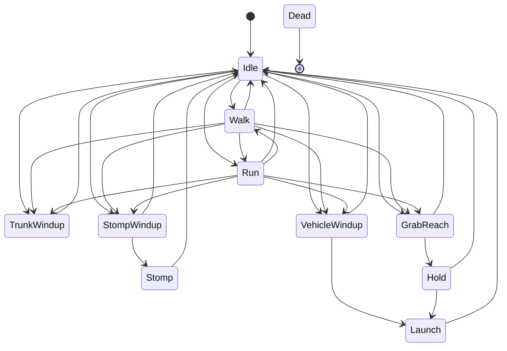

From any state: Dead

- **Idle**: Standing: nobody in reach, a stop distance reached, or waiting after a wipe. Every ended act comes back here.
- **TrunkWindup**: Log on the shoulder, turning to its target; the log flies when the wind-up ends (back to Idle).
- **StompWindup**: The telegraph; the shockwave starts when it ends. A wipe may cut it short.
- **Stomp**: The shockwave runs (BigfootRules.StompSeconds of pose).
- **VehicleWindup**: The vehicle is lifted overhead; it is thrown when the wind-up ends. A wipe or death drops it.
- **GrabReach**: Reaching for the nearest player on foot; holds them if still in reach, else back to Idle.
- **Hold**: Holds one player in its hand until the hold time runs out (launch) or the player dies or leaves (Idle).
- **Launch**: The short swing after a throw or a launch.
- **Dead**: Reachable from every act (a killing hit, or an admin ending the event).

## Bigfoot.Event

The server's Bigfoot event: none, a living Bigfoot, or the dead one lying out its death clip before it becomes the reward.

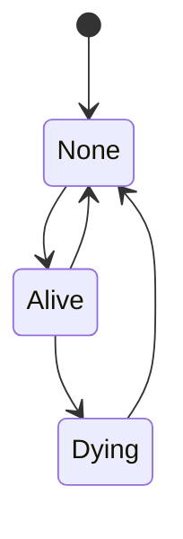

- **Dying**: The event is already won (the book has no running event) but a new Bigfoot may not start until the body is gone.

## Bigfoot.Life

Fighting, healed and waiting after a wipe, or dead.

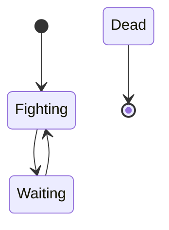

From any state: Dead

- **Waiting**: Wiped: healed to full, standing where it was, until a living player comes within the wake radius or a shot lands.
- **Dead**: Reachable from Fighting and Waiting (a shot can also kill a waiting one).

## Bigfoot.VehicleThrow

A vehicle the Bigfoot throws: lifted overhead, held until it is thrown (or put down), flying its scripted arc, landed.

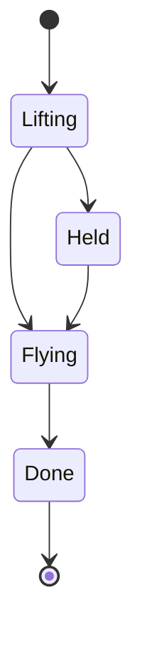

- **Held**: Overhead and still; one nobody throws is put down after a grace time (the Bigfoot died or was wiped with it up there).
- **Flying**: Also the put-down: the arc back to where it stood.

## Breath.Phase

Sniper breath hold: ready, holding (steady aim, the meter drains), forced exhale (heavy sway, cannot hold).

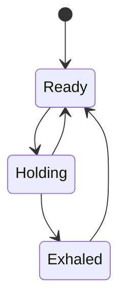

- **Ready**: Not holding: the meter refills. Also the phase whenever the weapon is not scoped or has no breath hold.
- **Holding**: The breath key is down, scoped, meter above 0 and not latched by a forced exhale: no sway, the meter drains.
- **Exhaled**: The meter ran out: sway x2.5 for breath_recover_seconds, the breath cannot be held; the key must be released before the next hold.

## CarePackage.Life

A care package crate: falls on its parachute, lands and can be opened, then ends opened or expired (the world manager despawns it once it has ended).

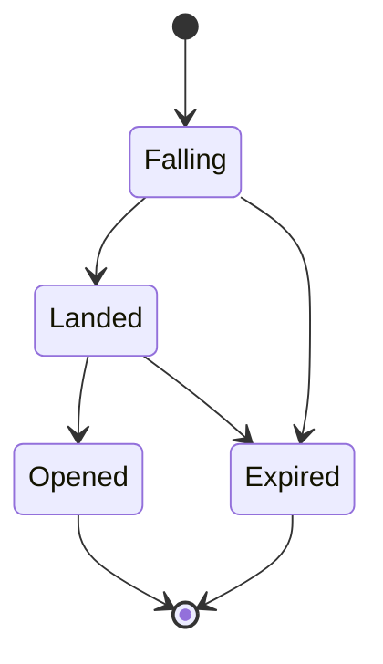

- **Falling**: Descending at the fall speed; not openable. The lifetime already runs (counted from the drop).
- **Landed**: On the ground (altitude at the landing point's Y): openable by anyone in reach.
- **Opened**: Opened by a player: ended, the reward is granted, the book despawns it at once. Cannot be reached from Expired.
- **Expired**: The lifetime ran out unopened: ended. An ended crate cannot be opened even before it is despawned.

## Casing.Phase

One spent casing: in the air or sliding, lying still on the floor, fading out, or a free slot.

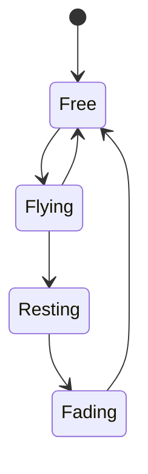

- **Flying**: Ballistic arc, then bounces off the surface normal (up to Bounces, each quieter) and a short slide; on a steep face it slides down instead of settling. Under water it sinks slowly, never bounces, never clinks. Ends lying still, or at once in the void (no floor 8 m below where it started).
- **Resting**: Lies flat on the floor for Stay seconds (a vehicle's roof: VehicleStay). Counts a clock; no movement, so its instance is not touched.
- **Fading**: Shrinks to nothing over FadeSeconds, then the slot is free.

## Church.Door

Should the church doors be open: shut or open, each with or without the deferred close-when-empty armed. The demon fight's door-grace clock runs beside (not a state).

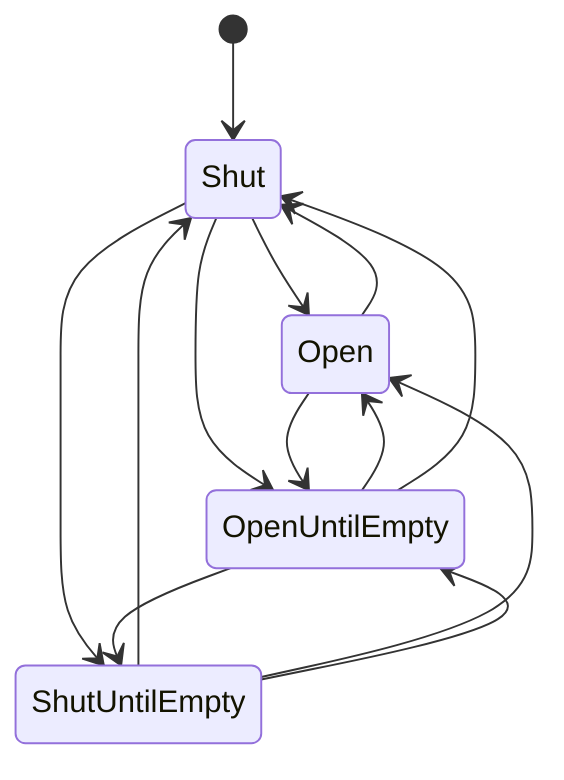

- **Shut**: Closed, nothing pending (the start state; the Mass void slams it, the deferred close lands here).
- **Open**: Open, nothing pending: the Mass gathers, an admin opened, or a cleared / failed demon fight let everyone out.
- **OpenUntilEmpty**: Open and the deferred close is armed (CloseWhenEmpty): the Mass is over or the demon died; the doors shut once the church is empty. The fight's door keeper may shut and reopen them meanwhile.
- **ShutUntilEmpty**: Shut with the deferred close armed: odd but kept. MassOver arms the close even while the doors are already shut (a void Mass, an admin's close); the church-empty check then fires it, a no-op for the doors, and clears the latch.

## Citizen.State

What a citizen of the Holy Mass is doing; the replicated state byte.

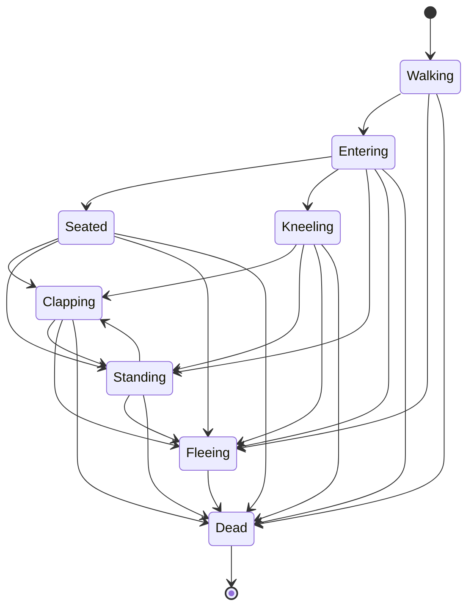

- **Walking**: On the navigation-mesh route from the house to the church door.
- **Entering**: On the scripted route inside the church to the seat.
- **Seated**: In a pew (a citizen) or at a desk (an Urad worker, spawned in place); the client plays the sit pose.
- **Dead**: Lies where it fell: a citizen's body is removed after the corpse time, the pastor's, a monk's and an Urad worker's lie until the event is cleared or the detour ends. Any hit kills in one.
- **Kneeling**: At a standing spot (a citizen).
- **Standing**: The pastor or a monk at their spot, or a citizen on its feet after the Mass.
- **Clapping**: The Mass is done and the body cheers (the pastor flexes).
- **Fleeing**: Sprinting home because the demon came; ends in removal at the spawn point (the entity ends, no state follows).

## Client.Link

The client's connection to the server: connecting, welcomed, spawned (own snapshot applied), and the two ends.

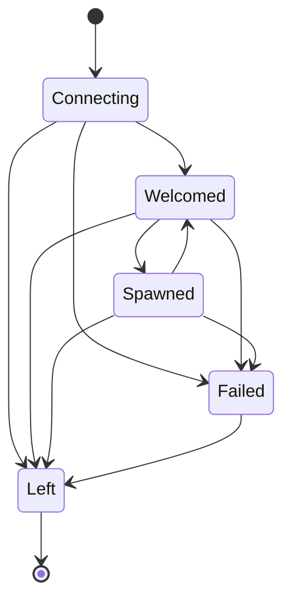

- **Connecting**: Elapsed is the time spent connecting (the client fails after 10 s).
- **Spawned**: Goes back to Welcomed at each respawn, until the new spawn position arrives.
- **Failed**: Frames and bot scripts stop; the menu was told.

## Corpse.Flight

A thrown body (corpse or target dummy): at rest on the ground, airborne after a launch or a drop until it lands, seated in a vehicle (a dead pilot or driver), or floating on water.

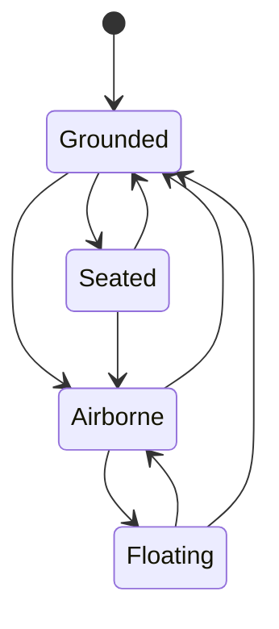

- **Grounded**: At rest. A launch (a push that is not zero) or a drop throws it; a dummy standing up again (Reset) comes back here.
- **Airborne**: Flying: the time in flight counts up and the flight ends after CorpseRules.MaxFlightSeconds whatever happens (it then snaps to the ground under it). Lands Grounded, or Floating when it lands in water. A new launch while airborne restarts the count.
- **Seated**: A dead pilot or driver still in the seat: the server moves it with the vehicle (Follow), it is not flown. Leaves by a drop or a throw (the vehicle at rest for CorpseRules.SeatedRestSeconds, or destroyed) or when a player boards its seat, which flings it out sideways.
- **Floating**: Lies at the water surface height where it landed, not flown. The client bobs and drifts it on the waves (cosmetic, nothing on the wire); it stays lootable until its lifetime ends.

## Demon.Phase

The demon's mind (Holy Mass): rests on an anchor, and from there roars, leaps, breathes fire, throws a fireball, pounces or crawls; a wipe sends it back to waiting, hits kill it.

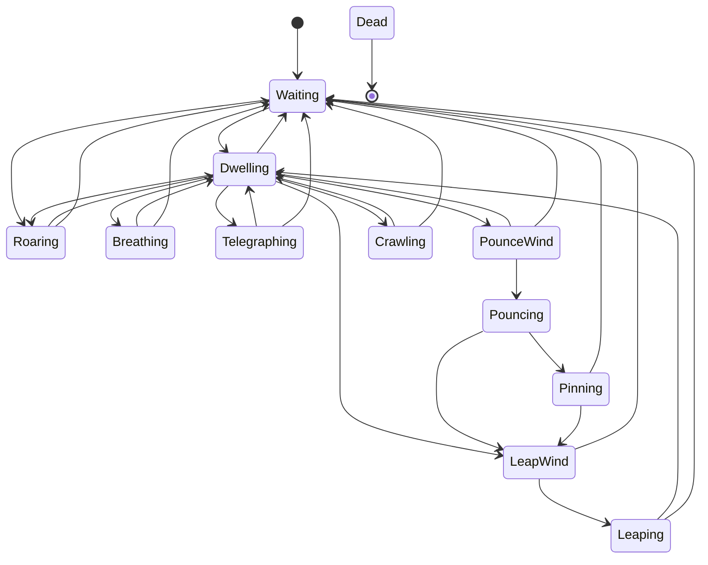

From any state: Dead

- **Waiting**: Still at its anchor: nobody has come in yet, or a wipe happened and the rearm delay is not over. A wipe in a crawl, leap or pounce lets that finish first (it waits where it gets to).
- **Dwelling**: Resting on an anchor facing its target: picks the next move when the dwell runs out (a due leap, flame and fireball come first).
- **Telegraphing**: The wind-up of a fireball; the telegraph event warns the clients. Back to Dwelling with the dwell it had.
- **Roaring**: Stopped on its anchor, roaring: when it wakes (if the data says so), at a health share, or on the roar clock.
- **LeapWind**: Crouched before a leap; also the crouch of the leap away that ends every pounce.
- **PounceWind**: Crouched and facing its victim, who is marked. Aborts (to Dwelling or Waiting) when the victim is gone.
- **Pouncing**: A homing arc to the victim's feet. Lands as Pinning, or, when the victim is gone, leaps away (LeapWind).
- **Pinning**: Standing over the pinned victim for the pin time, then leaps away. A wipe here leaves it standing on the floor until the rearm delay is over.
- **Dead**: Hits reached the hits needed. Final: a dead demon ignores hits and steps; Reset starts a new one.

## Demon.Pounce

The victim of a pounce: marked in the crouch (Wind), held on landing (Pinned), then let go as Released after the pin or Aborted when they leave or die, or the demon dies or is wiped.

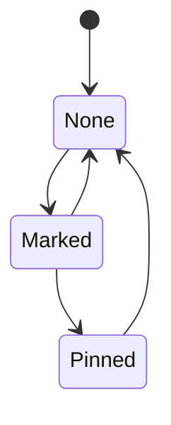

- **None**: Nobody marked. Every way back here sets the pounce cooldown and remembers the victim (never the same one twice while another qualifies).
- **Marked**: The victim is marked from the crouch to the landing; the host holds them back from health changes. Gone before the landing: Aborted, the demon finishes its leap with nobody pinned.
- **Pinned**: Lying flat on the floor under the demon. Pin time over: Released (the host sets their health). Gone, or the demon dies: Aborted.

## Demon.Stage

The server's script around the demon brain: the pastor turns, burns into the demon, climbs the wall, fights, dies; anything can end it early.

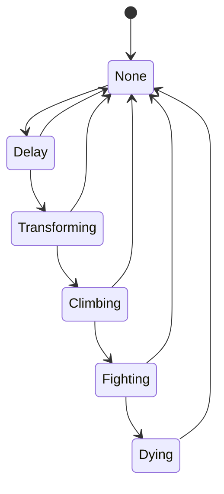

- **None**: No demon: the Mass is not void or the fight is cleared. Nothing ticks.
- **Delay**: The pastor has turned; his body still lies there for transform_delay_s. A failed spawn (entity cap) clears from here: the doors must still open.
- **Transforming**: The pastor's body is gone, the monks burn, the demon entity exists and cannot be hit (transform_s).
- **Climbing**: Scripted leap from the floor to the first anchor (climb_s); the entity is replicated as Crawling. Not yet hittable.
- **Fighting**: The DemonBrain runs; the demon is a hit target. Ends by its death (a weapon hit) or by a clear.
- **Dying**: The corpse lies for corpse_s; fireballs in the air still fly. Then the server ends the Mass.

## Demon.Wake

Whether the demon fights: it sleeps from the start of an event and after a wipe, wakes when a player is inside and the rearm delay is over.

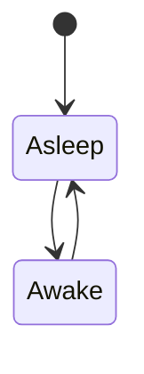

- **Asleep**: Resting phases show as Waiting; the health is back to full and the pounce, flame and leap clocks are cleared.
- **Awake**: Fighting: the hits needed grow with the players inside and never shrink; the fight clock, the roar clock and the leap clock run.

## Editor.Shape

The shape tools of the map editor (ground patches, zones): draw a polygon, ask for the water level, select a shape, drag one of its corners.

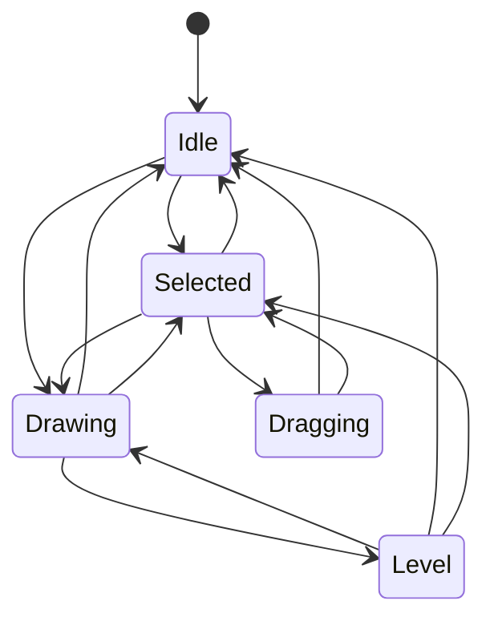

- **Idle**: No shape selected, nothing being drawn.
- **Drawing**: Corners placed (or N pressed and waiting for the first one); nothing saved. Esc cancels.
- **Level**: A patch of a water type is closed and asks for its water level; still nothing saved. Esc goes back to the corners.
- **Selected**: A saved shape is selected: its corners can be dragged or nudged, Del deletes it.
- **Dragging**: A corner follows the cursor; the file changes on release, Esc cancels.

## Editor.Sketch

The sketch tool of the map editor: corners of a line being drawn, a selected mark, or neither.

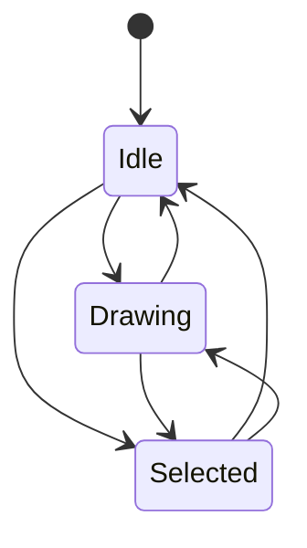

- **Idle**: A click marks a point or starts a line.
- **Drawing**: Corners of an unfinished line are placed; nothing is part of the sketch yet. Enter finishes, Esc cancels.
- **Selected**: One mark of the sketch is selected: Del deletes it, [ ] steps to the next.

## Engine.Sound

Which engine sound a vehicle makes (idle, accelerating, off the gas, braking, top speed), read from its speed.

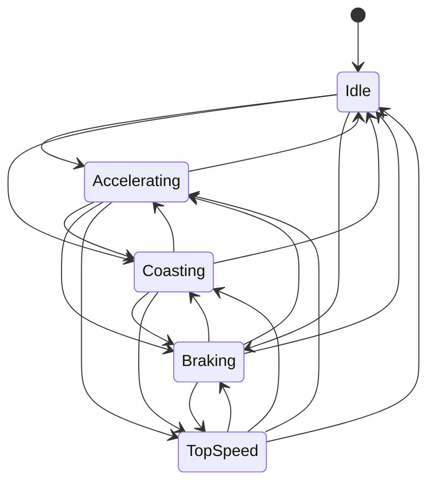

- **Idle**: standing: the idle loop
- **Coasting**: off the gas: only the background loop (the lift sound plays on the way in)

## Event.Run

One run of an event: active, then won (reward given) or despawned (no reward). Both ends are final.

```mermaid
stateDiagram-v2
    [*] --> Active
    Active --> Won
    Active --> Despawned
    Won --> [*]
    Despawned --> [*]
```

- **Won**: Concluded: the reward is due.
- **Despawned**: Timed out, cancelled or cleared by a round: no reward.

## Flock.Behaviour

What a flock of birds is doing: fly its tour of waypoints, or scatter away from a player or vehicle that came too close.

```mermaid
stateDiagram-v2
    [*] --> Cruise
    Cruise --> Scatter
    Scatter --> Cruise
```

- **Cruise**: Flies to a waypoint near home at the species' speed (no clock: a waypoint is reached by distance), then picks the next. A threat within scatter_radius_m sends it to Scatter.
- **Scatter**: Flies away from the threat, faster and climbing (clock: scatter_seconds), then returns to Cruise and heads for its next waypoint.

## GangMember.State

What a Gang member of a Raid is doing; the replicated state byte.

```mermaid
stateDiagram-v2
    [*] --> Idle
    Idle --> Walk
    Idle --> Guard
    Idle --> Chase
    Idle --> Seek
    Idle --> Flee
    Idle --> Board
    Walk --> Idle
    Walk --> Chase
    Walk --> Flee
    Walk --> Board
    Guard --> Idle
    Guard --> Chase
    Guard --> Flee
    Guard --> Board
    Chase --> Windup
    Chase --> Idle
    Chase --> Guard
    Chase --> Flee
    Chase --> Board
    Windup --> Swing
    Windup --> Idle
    Windup --> Guard
    Windup --> Flee
    Windup --> Board
    Swing --> Chase
    Swing --> Idle
    Swing --> Guard
    Swing --> Flee
    Swing --> Board
    Seek --> Approach
    Seek --> Chase
    Seek --> Flee
    Seek --> Board
    Approach --> Steal
    Approach --> ClimbUp
    Approach --> Seek
    Approach --> Chase
    Approach --> Flee
    Approach --> Board
    Steal --> Haul
    Steal --> Seek
    Steal --> Flee
    Steal --> Board
    Approach --> HopIn
    HopIn --> Steal
    HopIn --> Flee
    HopIn --> Board
    Steal --> HopOut
    HopOut --> Haul
    HopOut --> Seek
    HopOut --> Flee
    HopOut --> Board
    ClimbUp --> WorkAloft
    ClimbUp --> ClimbDown
    ClimbUp --> Flee
    ClimbUp --> Board
    WorkAloft --> ClimbDown
    WorkAloft --> Shocked
    WorkAloft --> Flee
    WorkAloft --> Board
    Shocked --> Falling
    Shocked --> Flee
    Shocked --> Board
    Falling --> Down
    Falling --> Flee
    Falling --> Board
    Down --> GetUp
    Down --> Flee
    Down --> Board
    GetUp --> ClimbUp
    GetUp --> Seek
    GetUp --> Flee
    GetUp --> Board
    ClimbDown --> Haul
    ClimbDown --> Seek
    ClimbDown --> Flee
    ClimbDown --> Board
    Haul --> Load
    Haul --> Seek
    Haul --> Flee
    Haul --> Board
    Load --> Seek
    Load --> Flee
    Load --> Board
    Board --> Flee
    Flee --> [*]
    Dead --> [*]
```

From any state: Dead

- **Idle**: A Thief standing (clock: a random time, then it walks to a point near the post); a Thief that has Loot work (its Raid gave it) goes straight on to Seek instead.
- **Walk**: A Thief on a route to a point near the post (clock: the time budget to arrive, then it stands again).
- **Guard**: An Enforcer follows the Thief it escorts, or stands at the post; the Gang boss stands at the post. Never steals.
- **Chase**: Runs at its own spot on a ring round the player the Raid is fighting (a route from the navigation mesh, asked for at most every repath_seconds); winds up once within reach. Ends (back to Idle or Guard) when the Raid forgets the player.
- **Windup**: The swing's telegraph (clock: windup_seconds): a player can step out of reach. Ends in Swing, or in a stand if the target is gone.
- **Swing**: The blow lands at its start, only if the target is still within reach; then recovers (clock: interval minus windup) and chases or stands again.
- **Flee**: Runs for the map edge on a route (clock: flee_seconds); the entity ends there (no state follows).
- **Dead**: Lies for corpse_seconds (the clock's elapsed time), then the entity ends. Reached from any state; never left.
- **Board**: Called back by the van: runs to its side door on a route (never fights) and ends there, counted as boarded. Flee when the van is destroyed or leaves without it.
- **Seek**: A Thief looks for a target: the nearest free one of a kind chosen by weight near the van's door, one Thief per target (clock: it asks again after seek_retry_seconds when nothing is free or the van takes no more). A Thief with free hands still joins a fight.
- **Approach**: Walks a route to the target's work spot (clock: approach_give_up_seconds; a target that is gone, a lost route or the clock ends it and the target is avoided for a while). Arrived: Steal, or ClimbUp when the target needs a climb.
- **Steal**: Stands at the target, a still target (clock: the kind's steal_seconds, or pickup_seconds for Loot that lies). When the clock runs out the Thief has it and it is gone from its place; a target that goes meanwhile ends it. Landed inside a fence (HopIn) it first walks straight to the pet and the clock starts within grab_m of it. A Working state.
- **Haul**: Carries the Loot to the van's door, faster than it approached (clock: haul_give_up_seconds, then it drops the Loot where it stands). A hit that does not kill it drops the Loot where it stands too (gang.hit_drops_loot; Load, ClimbDown and HopOut as well) and it seeks again, with free hands, so it joins the fight. A Working state; the client attaches the prop from the hp byte.
- **Load**: Tosses the Loot into the van at the door (clock: load_seconds): counted in the van, the Thief seeks again. A van that cannot take it any more gets it dropped at the Thief's feet.
- **ClimbUp**: Climbs straight up from the climb's base to its top at climb_speed, off the navigation mesh (no clock: the distance). A Working state; shot dead here it falls to the ground.
- **WorkAloft**: Works at the top of the climb (clock: the kind's steal_seconds), then has the thing. A Working state; shot dead here it falls to the ground.
- **ClimbDown**: Climbs straight down to the base at climb_speed, then hauls what it has (or seeks again when it has nothing). A Working state; shot dead here it falls to the ground.
- **HopIn**: Hops over the fence of the pet's garden: an arc from the point outside the fence to the point inside it, off the navigation mesh (clock: hop_seconds). A Working state; then Steal, where it walks to the pet.
- **HopOut**: Back out of the garden with the pet (or with nothing when the pet went): walks straight to where it landed (no clock), then the arc out over the fence (clock: hop_seconds), then Haul with the pet. A Working state.
- **Shocked**: Electrocuted at the top of a climb (the kind's hazard rolled when the Thief started to work aloft; clock: the shock's seconds): held in place, beams and sound on the clients. Costs no hits. Ends in Falling; shot dead here it falls and lies.
- **Falling**: Falls from the top to the base's height under gravity (no clock: the height), off the navigation mesh. Ends in Down; shot dead here it keeps falling and lies.
- **Down**: Lies knocked down (clock: the shock's down seconds); a lying hit volume, normal hits count. Ends in GetUp.
- **GetUp**: Gets up (clock: the shock's get-up seconds), then goes for the same target again (ClimbUp), or looks for another when it is gone (Seek). All four are Working states: the Thief does not fight.

## Garage.Door

The bus garage's double doors: a player on foot at the doorway opens and closes them with the interact key.

```mermaid
stateDiagram-v2
    [*] --> Shut
    Shut --> Open
    Open --> Shut
```

- **Shut**: Closed and solid (the start state, and every new server): the leaves fill the doorway.
- **Open**: The leaves are swung out into the yard and nothing is solid. Stays open until a player closes it; it does not close while a vehicle stands in the doorway.

## Harvester.Ai

The AI harvester's job: drive to the field's first pass, cut the passes with turns between, leave along the edge; stops when its driver is killed.

```mermaid
stateDiagram-v2
    [*] --> Approach
    Approach --> Cut
    Approach --> Leave
    Cut --> Turn
    Cut --> Leave
    Turn --> Cut
    Turn --> Leave
    Leave --> Gone
    Gone --> [*]
    Stopped --> [*]
```

From any state: Stopped

- **Approach**: Appeared just inside the field's outline, facing the first pass.
- **Cut**: Driving a pass at cutting speed; the cut progress (pass, metres) is what the clients draw the stubble from.
- **Turn**: Out past the end of the pass, across, and back in on the next one (a bulb turn).
- **Leave**: The edge route to where it came in, then past it. A plan whose passes were all given up goes straight here.
- **Gone**: Reached the exit: the event is over (cooldown starts).
- **Stopped**: Its driver died, or an admin ended the event: from any phase. The brain gives no more commands.

## Harvester.Corpse

A victim of the harvester: drawn in at the front, inside the machine for a few seconds, then ejected as a bale at the unloader.

```mermaid
stateDiagram-v2
    [*] --> Drawn
    Drawn --> Inside
    Inside --> Baled
    Baled --> [*]
```

- **Drawn**: The body slides from where it fell to the intake at the front; it cannot be looted meanwhile.
- **Inside**: Gone from the world (the corpse entity is removed, its Items are kept for the bale).
- **Baled**: The bale is spawned at the unloader with the Items. The end.

## Hay.Bale

A hay bale: whole, set alight by a shot, burning for a few seconds, then ash.

```mermaid
stateDiagram-v2
    [*] --> Intact
    Intact --> Burning
    Burning --> Ash
    Ash --> [*]
```

- **Intact**: Any shot that reaches it ignites it (a bullet, a pellet). A harvester's bale starts here too.
- **Burning**: Fire for BaleBurnSeconds; everyone close enough is ignited each tick. Nobody is credited for those burns.
- **Ash**: Burnt out: a dark heap. Stays until the bale despawns (a corpse's lifetime) or the round ends; it cannot be lit again.

## HelicopterGunner.Phase

The helicopter's gun cycle: wait, warn the picked enemy, fire a burst, wait again.

```mermaid
stateDiagram-v2
    [*] --> Waiting
    Waiting --> Warning
    Warning --> Burst
    Warning --> Waiting
    Burst --> Waiting
```

- **Waiting**: Counting down the cycle gap; at zero it picks the best visible enemy (none: waits another gap). No target.
- **Warning**: The target has its red-dot warning; at zero the burst starts if it is still visible, else back to Waiting.
- **Burst**: One round each round interval while the target stays visible; the last round or a lost target goes back to Waiting.

## Hud.MoabBanner

The MOAB's top-centre banner: countdown, then the blast or the cancelled line.

```mermaid
stateDiagram-v2
    [*] --> Idle
    Idle --> Countdown
    Idle --> Blast
    Idle --> Cancelled
    Countdown --> Idle
    Countdown --> Blast
    Countdown --> Cancelled
    Blast --> Idle
    Blast --> Countdown
    Blast --> Cancelled
    Cancelled --> Idle
    Cancelled --> Countdown
    Cancelled --> Blast
```

- **Idle**: No panel. The countdown running out without a Blast event (the server's) also ends here.
- **Countdown**: Armed: the seconds left, rounded up, until detonation. Armed again restarts it; a banner still showing is replaced.
- **Blast**: Detonation: the owner's name for 3 s; the flash (0.6 s, none with reduce motion) runs on its own clock and may outlive a re-armed banner.
- **Cancelled**: The countdown was stopped: the line for 3 s.

## Hud.PanelFade

A full-screen overlay's open/close fade (Equipment screen, tactical map).

```mermaid
stateDiagram-v2
    [*] --> Closed
    Closed --> Opening
    Closed --> Open
    Opening --> Open
    Opening --> Closing
    Opening --> Closed
    Open --> Closing
    Open --> Closed
    Closing --> Closed
    Closing --> Opening
    Closing --> Open
```

- **Closed**: Hidden and not processing; the first frame after Show makes it visible.
- **Opening**: Wanted open, alpha ramping up (the fade is 150 ms, none with reduce motion).
- **Open**: Wanted open at full alpha. Reduce motion jumps Closed -> Open and Open -> Closed.
- **Closing**: Not wanted, alpha ramping down; Show during it turns back to Opening from the current alpha.

## Interact.Hold

One hold of the interact key at a crate or a rozhlas set: idle, charging toward the send, sent once and waiting for the key to be released.

```mermaid
stateDiagram-v2
    [*] --> Idle
    Idle --> Charging
    Charging --> Sent
    Charging --> Idle
    Sent --> Idle
```

- **Idle**: Key up, or held with nothing in reach (Held is 0).
- **Charging**: Key held at something in reach and the open request is not sent yet: Held counts up.
- **Sent**: The open request is sent: nothing more until the key is released. Leaving reach zeroes Held but stays Sent; a despawn (Reset) ends it too.

## Killstreak.Hold

One loadout streak in one life: kills to go, earned and held, used.

```mermaid
stateDiagram-v2
    [*] --> Progress
    Progress --> Earned
    Earned --> Used
    Earned --> Progress
    Used --> Progress
```

- **Progress**: Not earned: the Streak counter is below the threshold (the start of every life).
- **Earned**: Threshold reached (StreakEarned sent): held until the owner uses it.
- **Used**: Activation accepted (StreakUsed sent): spent for this life, whether it still runs or has ended. Only a death or a round reset brings it back to Progress.

## Killstreak.Slot

A loadout streak slot on the HUD tracker: kills to go, ready to use, running, spent for this life.

```mermaid
stateDiagram-v2
    [*] --> Empty
    Empty --> Progress
    Progress --> Ready
    Progress --> Active
    Ready --> Active
    Ready --> Progress
    Active --> Spent
    Active --> Progress
    Spent --> Active
    Spent --> Progress
```

- **Empty**: No streak (or an unknown id) in the slot; set by Arm, never left except by the next Arm.
- **Progress**: Not earned: kills still to go. The state of every streak at the start of a life.
- **Ready**: Earned (StreakEarned) and held: the Killstreak key uses it.
- **Active**: Used (StreakUsed) and running until StreakEnded.
- **Spent**: Used and ended this life; it comes back only after a death or a round reset.

## Killstreak.Use

One activation of a killstreak: inside Activate, running, ended; or refused and dropped.

```mermaid
stateDiagram-v2
    [*] --> Activating
    Activating --> Open
    Activating --> Refused
    Activating --> Ended
    Open --> Ended
    Refused --> Ended
    Ended --> [*]
```

- **Activating**: The service called the implementation's Activate and has not heard back. A use that ends here is completed (event, callbacks) after Activate returns, once StreakUsed went out.
- **Open**: Accepted and running until its duration, its own End, its owner's death or leaving, a round reset, or its aircraft's destruction.
- **Refused**: Activate returned false: dropped by the service, the streak stays held. Never ended by the framework.
- **Ended**: Over: EndReason is set, StreakEnded sent, callbacks run.

## Loadout.Autosave

One loadout slot's save: debounce, one send on the wire, ack or retry with backoff; an explicit rejection stops the retries.

```mermaid
stateDiagram-v2
    [*] --> Saved
    Saved --> Pending
    Pending --> Saving
    Saving --> Saved
    Saving --> Pending
    Saving --> Rejected
    Saving --> Retrying
    Retrying --> Saving
    Rejected --> Pending
```

- **Saved**: Nothing unsent or in flight; no draft.
- **Pending**: Draft waiting for its quiet period (or for the answer to an older send) before it goes out.
- **Saving**: One save for the slot is on the wire. An edit meanwhile only marks the draft newer; it goes after the answer.
- **Retrying**: The send failed (timeout, no connection): resent with backoff. An edit meanwhile keeps the backoff clock and rides the next try.
- **Rejected**: The server refused the draft: shown with its reason, kept, never resent until the next edit or undo.

## Loot.Piece

Where one piece of Loot is: at its place, claimed by a Thief, carried, lying on the ground (claimed or not) or loaded in a van.

```mermaid
stateDiagram-v2
    [*] --> AtPlace
    AtPlace --> Claimed
    AtPlace --> Lying
    Claimed --> AtPlace
    Claimed --> Carried
    Carried --> Lying
    Carried --> Loaded
    Carried --> AtPlace
    Lying --> LyingClaimed
    Lying --> AtPlace
    LyingClaimed --> Lying
    LyingClaimed --> Carried
    LyingClaimed --> AtPlace
    Loaded --> AtPlace
```

- **AtPlace**: In the world where it belongs (a wheel on its car, a dish on its wall, a pet in its garden) and free to be chosen; also where a piece that is gone for good (a pet killed in a Thief's hands) ends. Not tracked: no machine exists for it. A kind that grows back (a pole after its cooldown) offers a new piece under the old id while the old one is still away: its claim starts the new life here and the old one's is forgotten.
- **Claimed**: One Thief goes for it or works at it (the registry's claim): no other chooses it. Ends when the Thief takes it, gives up, is called off or dies, or the thing goes (a car driven off).
- **Carried**: In a Thief's hands (hp byte of the member), gone from its place: hauled to the van's door. Ends in the van, on the ground (killed, hit, gave up), or back at its place (a kind that does not lie, a van that cannot take it). A Thief that flees with it runs off with it: it stays Carried until the round resets.
- **Lying**: On the ground as a world entity (capped): a Thief may take it up, a player sends it back. Also entered by a piece put down with no carrier (tools, tests): AtPlace goes straight to Lying.
- **LyingClaimed**: A Thief goes to take up the Loot that lies. The Loot may be sent back or capped away meanwhile: the claim then lapses with it.
- **Loaded**: Counted in a van (Raid.Loaded). Comes back to its place when the van is destroyed; stays with a van that drives off.

## Loot.ReturnHold

One hold of the use key on lying Loot to send it back: idle, counting in reach, or spent (done, or interrupted by a hit) until the key is released.

```mermaid
stateDiagram-v2
    [*] --> Idle
    Idle --> Holding
    Idle --> Spent
    Holding --> Idle
    Holding --> Spent
    Spent --> Idle
```

- **Idle**: Key up, or held with no Loot in reach (Held and Target are 0).
- **Holding**: Key held within reach of Loot: Held counts up on Target; other Loot or leaving reach starts it over. Completes once Held reaches the return seconds.
- **Spent**: Completed (the return fires once) or interrupted by a hit (also with the key up: the press of that same input counts for nothing): nothing more until the key is released.

## Mass.Pastor

Whether the pastor stands ready, so the Mass progresses, or a killed one is being replaced.

```mermaid
stateDiagram-v2
    [*] --> Off
    Off --> Ready
    Off --> Gone
    Ready --> Gone
    Ready --> Off
    Gone --> Arriving
    Gone --> Off
    Arriving --> Settling
    Arriving --> Gone
    Arriving --> Off
    Settling --> Ready
    Settling --> Gone
    Settling --> Off
```

- **Off**: Not tracked: no event, or the Mass is over or void (the pastor no longer pauses anything).
- **Ready**: He stands at his spot and the pause after a kill is over: the chant plays.
- **Gone**: Killed (or the first spawn was refused): a new one walks out after PastorReplaceSeconds; a refused spawn retries every second.
- **Arriving**: The replacement walks from the sacristy door to the pastor's spot.
- **Settling**: He stands at his spot; the Mass resumes after ResumeSeconds.

## Mass.Phase

The Holy Mass event timeline: gather, Mass, done or void.

```mermaid
stateDiagram-v2
    [*] --> Idle
    Idle --> Gather
    Idle --> Void
    Gather --> Mass
    Gather --> Completed
    Gather --> Void
    Gather --> Idle
    Mass --> Completed
    Mass --> Void
    Mass --> Idle
    Completed --> Void
    Completed --> Idle
    Void --> Idle
```

- **Idle**: No event. Start begins the gather; an admin ForceTurn from here starts one that is void at once.
- **Gather**: The bells ring, citizens walk in and sit. Ends when everyone is in place (StartDelaySeconds) or when the gather timer runs out, whichever comes first; Conclude skips to Completed.
- **Mass**: The chant runs; progress counts only while the pastor is ready. Ends at MassSeconds of progress, or by Conclude.
- **Completed**: The blessed are chosen, citizens stand and clap, the pastor flexes. Lingers CompletedSeconds, then the event ends. An admin ForceTurn can still void it.
- **Void**: The pastor turned (third kill or ForceTurn): the demon's cue, citizens sprint home, no blessing. Stays until End or Conclude.

## Mass.Seat

What a player is told about the Holy Mass seats: nothing, a free seat in reach, or sitting.

```mermaid
stateDiagram-v2
    [*] --> None
    None --> CanSit
    None --> Seated
    CanSit --> None
    CanSit --> Seated
    Seated --> None
```

- **None**: No seat in reach, not in the event, or just stood up.
- **CanSit**: A free seat is in reach: the client shows the sit prompt.
- **Seated**: Sitting: the server holds the body, the client does not predict it. Interact or jump stands up; death, a car, the end of the Mass and the blessing end it too.

## Match.Phase

The match loop: waiting for players, a running round, the end screen.

```mermaid
stateDiagram-v2
    [*] --> Waiting
    Waiting --> Running
    Running --> Ending
    Running --> Waiting
    Ending --> Running
    Ending --> Waiting
```

- **Waiting**: Fewer than MinPlayers (nobody, in the shipped match.json). Scores and lives are reset; the next join or restart starts a round.
- **Running**: Time limit counts down from the round start. Left by the time limit or score goal (Ending), too few players (Waiting). An admin restart re-enters it with a fresh round.
- **Ending**: End screen for EndScreenTime; hits are ignored. Then a new round starts by itself.

## Match.PlayerLife

Whether a player is in the world: unspawned, alive or dead awaiting the respawn.

```mermaid
stateDiagram-v2
    [*] --> Unspawned
    Unspawned --> Alive
    Alive --> Dead
    Alive --> Unspawned
    Dead --> Alive
    Dead --> Unspawned
```

- **Unspawned**: Not in the world: before the first spawn, or between a round reset and the spawn that follows it. Hits are ignored.
- **Alive**: In the world with health. Spawn protection (ProtectedUntil), a blessing's invulnerability and the demon's hold are timers beside this state.
- **Dead**: Awaiting RespawnAt (the respawn delay after the lethal hit).

## MechanicGarage.Lights

The garage interior's lights after the plate breaks: dark, then a flicker that lights nothing, then fully on.

```mermaid
stateDiagram-v2
    [*] --> Sealed
    Sealed --> Dark
    Sealed --> On
    Dark --> Flicker
    Dark --> On
    Dark --> Sealed
    Flicker --> On
    Flicker --> Sealed
    On --> Sealed
```

- **Sealed**: The plate stands (the start state): the lights are off and nothing of the room can be seen.
- **Dark**: The plate has just broken: the room is dark.
- **Flicker**: The tubes of the roof lights flash a few times; the real lights stay off, so the Golf is not lit.
- **On**: The lights are on: they come up over a moment, or at once for a client that arrived later.

## Menu.Connect

The connect screen: edit the target, probe it with a visible timeout, show what went wrong.

```mermaid
stateDiagram-v2
    [*] --> Form
    Form --> Connecting
    Form --> Error
    Connecting --> Form
    Connecting --> Error
    Error --> Form
    Error --> Connecting
```

- **Form**: Fields editable. Connect is enabled only for a valid form. A failed join or lost connection reopens the screen as Error instead.
- **Connecting**: Probe running; its sockets are released when this state ends, however it ends. Success hands over to loading (the screen is replaced).
- **Error**: Probe failed (timeout, refused, unresolvable, local socket) or the last join failed. Try again goes straight back to Connecting.

## Moab.Phase

A MOAB from call-in to blast: counting down, then detonated or cancelled.

```mermaid
stateDiagram-v2
    [*] --> Armed
    Armed --> Detonated
    Armed --> Cancelled
    Detonated --> [*]
    Cancelled --> [*]
```

- **Armed**: Called in: the countdown (the streak's duration) runs; only one is pending per match.
- **Detonated**: The countdown ran out (the use ended as Expired): everyone but the owner dies, vehicles blow up.
- **Cancelled**: The use ended any other way: owner died or left, round reset, or a sandbox owner used it again (Replaced; the new one's Armed follows at once). No blast.

## Net.RenderClock

The render clock of remote entities: unsynced until the first snapshot, then tracking the estimated server present, holding the drawn tick while a late snapshot has moved the estimate behind it.

```mermaid
stateDiagram-v2
    [*] --> Unsynced
    Unsynced --> Tracking
    Tracking --> Holding
    Holding --> Tracking
```

- **Unsynced**: No snapshot yet: RenderTick returns the raw target and the drawn tick is not recorded.
- **Tracking**: The drawn tick follows the estimate (it never moves backwards).
- **Holding**: The estimate moved behind the drawn tick: the drawn tick stays put until the estimate passes it again. One episode counts once in HoldEvents.

## Player.DeathView

The local player's death screen: the legs give way, the body goes over and the blood spatters, then it lies there under the respawn scrim until the spawn.

```mermaid
stateDiagram-v2
    [*] --> Buckling
    Buckling --> Falling
    Falling --> Lying
    Lying --> [*]
```

- **Buckling**: Clock: the buckle length. The knees or the lean give way and the view sinks part of the way; a little blood. Zero seconds for a death that does not move the camera.
- **Falling**: Clock: the fall length. The body goes over (forward, back, left or right by the plan) and the view hits the ground; the blood grows to full. Zero seconds for a plain fade.
- **Lying**: Held until the spawn ends it. Clock (elapsed): the impact shake, then the scrim fade-in with the "eliminated by" text and the countdown.

## Pounce.View

The client's view of the demon's pounce: a victim is marked (Wind), pinned flat, then let go; the local victim's camera rises back afterwards.

```mermaid
stateDiagram-v2
    [*] --> None
    None --> Wind
    None --> Pinned
    Wind --> Pinned
    Wind --> None
    Pinned --> Rising
    Pinned --> None
    Pinned --> Wind
    Rising --> None
    Rising --> Wind
    Rising --> Pinned
```

- **None**: Nobody is marked or held (also after the demon is gone).
- **Wind**: A victim is marked: the local victim's look is locked on the demon. A joiner can start here.
- **Pinned**: The victim lies pinned. Locally: the body is the server's (no prediction, no weapon), the camera is on the floor. A joiner can start here.
- **Rising**: The local victim was let go: the camera rises back to standing height while the red fades. Only after a pin of the local player.

## RaidVan.State

What a Raid van is doing; the replicated state byte.

```mermaid
stateDiagram-v2
    [*] --> Arriving
    Arriving --> Opening
    Opening --> Parked
    Parked --> Boarding
    Parked --> Closing
    Boarding --> Closing
    Closing --> Leaving
    Leaving --> [*]
    Destroyed --> [*]
```

From any state: Destroyed

- **Arriving**: Drives the road path from the map edge to the stop at its speed (it brakes only for the stop, never for what is in its way); no clock. Ends in Opening at the stop.
- **Opening**: Stopped; the side door slides open (clock: door seconds) and the crew starts getting out, one every stagger seconds.
- **Parked**: The crew works (the stay clock runs beside). Leaves for Boarding (or Closing when nobody is afoot) when the Loot loaded reaches capacity or the stay time ran out; a dead crew does not send it off.
- **Boarding**: The living crew is called back (clock: board wait seconds); ends when none is afoot, or the wait ran out (those left behind flee).
- **Closing**: The door slides shut (clock: door seconds), then the van drives off.
- **Leaving**: Drives the way out to the map edge, accelerating; the entity ends at its end (no state follows).
- **Destroyed**: Hit count taken, from any state: the Raid is over. The wreck lies where it stopped (clock: wreck seconds), then the entity ends. Never left.

## Rozhlas.Phase

The village loudspeaker: a detour broadcast, and the hijack after the announcer is killed.

```mermaid
stateDiagram-v2
    [*] --> Idle
    Idle --> OnAir
    OnAir --> Idle
    OnAir --> Hijacked
    Hijacked --> Idle
```

- **Idle**: Nothing runs; the Urad is sealed. A scheduled slot (every PeriodS) or an admin's /event rozhlas starts a broadcast.
- **OnAir**: A detour broadcast plays for the length of its recording (the Urad is open, the mic is live). Ends by itself, or on AnnouncerKilled.
- **Hijacked**: The announcer was killed: the announcement is cut and the mic stays live for exactly HijackSeconds from the kill. One per broadcast, never refreshed.

## Rozhlas.Set

Who holds the rozhlas set (the mic at the dictation table): nobody, or one player while the mic is hijacked.

```mermaid
stateDiagram-v2
    [*] --> Free
    Free --> Held
    Held --> Free
```

- **Free**: Nobody is on the mic. A player may take it, only while the loudspeaker is Hijacked.
- **Held**: One player holds it (Holder). Released by their death, disconnect, hijack end, entering a vehicle, walking more than 2 m from the table (once it exists) or an explicit release.

## RozhlasFeed.Jitter

The client's jitter buffer for the live feed: wait for ~100 ms of frames, play them out, wait again after running dry.

```mermaid
stateDiagram-v2
    [*] --> Priming
    Priming --> Playing
    Playing --> Priming
```

- **Priming**: Frames are collected; nothing plays until the target depth is reached.
- **Playing**: One frame per 20 ms in sequence order; a missing one is concealed, a late one dropped; an empty buffer goes back to Priming.

## RozhlasFeed.Session

Whether the live feed (ffmpeg subprocess, 2 s delay line) is running for a mic-live phase.

```mermaid
stateDiagram-v2
    [*] --> Idle
    Idle --> Live
    Idle --> Failed
    Live --> Draining
    Live --> Failed
    Draining --> Idle
    Draining --> Live
    Draining --> Failed
    Failed --> Idle
    Failed --> Live
```

- **Idle**: No process. Nothing is sent.
- **Live**: Start() ran: input is accepted and pulled at a steady 50 blocks/s into ffmpeg; the degraded output goes out 2 s after its input.
- **Draining**: Stop() ran: no new input; what was written still plays out, then the echo tail, then ffmpeg ends. A Start() here cuts the tail short.
- **Failed**: ffmpeg missing, died, or stopped producing audio: logged once, the feed is silent until the next phase. Never unprocessed audio.

## Session.Phase

A connection on the server: connected, said hello (profile loading) or refused, then joined.

```mermaid
stateDiagram-v2
    [*] --> Connected
    Connected --> Rejected
    Connected --> Loading
    Connected --> Joined
    Loading --> Joined
    Rejected --> [*]
    Joined --> [*]
```

- **Connected**: Only a hello is read; a connection with none after the hello deadline is dropped.
- **Rejected**: Terminal: nothing more is read from the peer.
- **Loading**: Joined when the profile arrives, or as a guest when the load fails or times out.
- **Joined**: Inputs, events and the snapshots flow. A bot is created here; a guest (no profile store or token) skips Loading.

## Target.Dummy

A target dummy: standing, or down until it respawns.

```mermaid
stateDiagram-v2
    [*] --> Standing
    Standing --> Down
    Down --> Standing
```

- **Standing**: Hits register. Killed by the hit that takes its health to zero.
- **Down**: Ignores hits until RespawnAt (the match clock), unless Respawns is off (sandbox): then until the round restarts.

## Thieves.Phase

The Thieves event: idle until started, raiding while its wave of vans is in the village, then over until the round resets.

```mermaid
stateDiagram-v2
    [*] --> Idle
    Idle --> Raiding
    Raiding --> Over
    Raiding --> Idle
    Over --> Raiding
    Over --> Idle
```

- **Idle**: Nothing runs: never started, or a round reset cleared it.
- **Raiding**: The convoy's vans are launched one after another (no clock of its own: the convoy-gap clock runs beside) and come and go. Left by Finish (won when every van of the wave is gone, or an admin's end or cancel) or by a round reset.
- **Over**: Won or cancelled; what was stolen stays stolen. A new /event thieves starts it again, a round reset clears it.

## Turret.State

A sentry turret: the placing ghost, then armed and idle, acquiring a target (the outplay delay), or aiming and firing.

```mermaid
stateDiagram-v2
    [*] --> Placing
    Placing --> Idle
    Idle --> Acquiring
    Idle --> Aiming
    Acquiring --> Aiming
    Acquiring --> Idle
    Aiming --> Acquiring
    Aiming --> Idle
```

- **Placing**: A ghost that follows the owner's aim; Place arms it when the spot is valid. Only the owner sees it.
- **Idle**: Armed, no target: scans for enemies at the repick rate.
- **Acquiring**: Has a target and turns towards it, but holds fire for acquire_delay_s (the outplay window; the machine's clock). A different target restarts the delay.
- **Aiming**: Past the delay: turns, and shoots once within the aim tolerance and off cooldown. Idle again when the target is lost; Idle goes straight here when the delay is 0.

## Vehicle.Gun

A vehicle gun: ready to fire, or reloading.

```mermaid
stateDiagram-v2
    [*] --> Ready
    Ready --> Reloading
    Reloading --> Ready
```

- **Ready**: Fires one round per FireInterval while the trigger is held and the magazine has one.
- **Reloading**: No rounds until the reload time is over; the magazine is topped up from the reserve when it ends. The end is noticed by the next trigger update, not by a timer.

## Vehicle.Life

A server-side vehicle: alive, doomed (blast scheduled), destroyed until it returns.

```mermaid
stateDiagram-v2
    [*] --> Alive
    Alive --> Doomed
    Doomed --> Destroyed
    Doomed --> Alive
    Destroyed --> Alive
```

- **Alive**: Hit points above zero. A return that does not repair (out of the world) keeps a damaged vehicle damaged.
- **Doomed**: Hit points are zero and DetonateAt is set: the blast goes off when the clock reaches it (the chain delay after a neighbour's blast, else this tick). A return repairs it.
- **Destroyed**: Blown up, no collision, nobody aboard. ReturnAt is set; the return repairs it and puts it back at its origin.

## Vehicle.ThrowGuess

The driver's client shows an animal its predicted vehicle hit as thrown before the server says so, then hands the picture over to the server's.

```mermaid
stateDiagram-v2
    [*] --> None
    None --> Flying
    Flying --> Confirmed
    Flying --> Settling
    Confirmed --> Settling
    Settling --> None
```

- **None**: Drawn where the server has it (plus what is left of the last offset). A touch of the predicted vehicle starts Flying.
- **Flying**: Flies on the guessed arc (clock: ConfirmSeconds). The server's throw showing makes it Confirmed; the clock running out (a miss) makes it Settling, the difference to the server's position the offset.
- **Confirmed**: The server shows the throw, later than the guess: the guessed arc is kept, and the body lies where it lands, until the server's body has landed too (clock: LandSeconds, a guard). Then Settling, the difference of the two landing spots the offset.
- **Settling**: Drawn at the server's position plus the fading offset (clock: SettleSeconds); no new guess, as the server throws one body once in that time.

## WorldInterest.Relevance

One filtered world entity as one client's encoder sees it: keyframed until the client has it, then delta, then dormant (hidden) until it is acknowledged, then silent. Ticks are acknowledgements, not seconds.

```mermaid
stateDiagram-v2
    [*] --> Unseen
    Unseen --> Keying
    Unseen --> Leaving
    Keying --> Synced
    Keying --> Leaving
    Synced --> Keying
    Synced --> Leaving
    Leaving --> Keying
    Leaving --> Silent
    Silent --> Keying
```

- **Unseen**: No entry in the table. In range it goes to Keying. Out of range it stays Unseen, except when the client has no baseline (a full set): then it goes to Leaving so the client hides it.
- **Keying**: A keyframe every tick until the client acknowledges a tick at or after the first one (entered at 800 m). A lost packet is repaired by the next tick's keyframe.
- **Synced**: Deltas against the shared baseline. Goes back to Keying if the baseline does not hold the entity (a safety net).
- **Leaving**: The dormant record every tick until the client acknowledges a tick at or after the first one (left at 850 m). Never a removal: the entity is alive.
- **Silent**: The client has the dormant record. Nothing is sent until the entity enters again.

