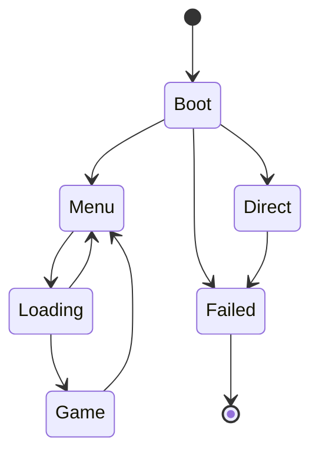
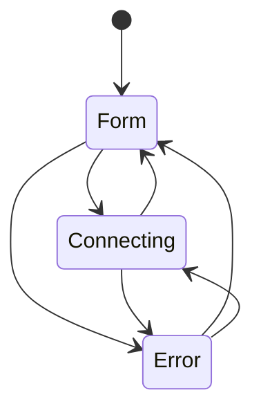

# State machines

Generated from the specs in `godot/ShooterCore/Fsm/StateMachineCatalog.cs` by `StateMachineCatalogTests`. Do not edit by hand: change the spec, then run
`UPDATE_STATE_DOCS=1 dotnet test godot/ShooterCore.Tests --filter StateMachineCatalogTests`.

How to add or change one: see `godot/ShooterCore/Fsm/StateMachine.cs`. `*` means "from any state".

## App.Phase

Boot, menus, loading, a running match; the one value the shooter's entry point and menu shell hang their behaviour on.

- **Boot**: Menu: client with a display and no smoke or script flags. Direct: server, offline, smoke, bot roles. Failed: startup threw.
- **Menu**: Entered again after a cancelled or failed join (connect screen with the reason) and after leaving or losing a match (toast).
- **Loading**: Left for Game when the server welcomes us; back to Menu when cancelled, failed, or the connection dropped meanwhile.
- **Game**: Left only for Menu: Disconnect from Pause, or the server dropped us.
- **Direct**: No menus; ends with the process, or Failed when loading the data or map threw.
- **Failed**: Terminal: Quit(2) was requested.

## Menu.Connect

The connect screen: edit the target, probe it with a visible timeout, show what went wrong.

- **Form**: Fields editable. Connect is enabled only for a valid form. A failed join or lost connection reopens the screen as Error instead.
- **Connecting**: Probe running; its sockets are released when this state ends, however it ends. Success hands over to loading (the screen is replaced).
- **Error**: Probe failed (timeout, refused, unresolvable, local socket) or the last join failed. Try again goes straight back to Connecting.

