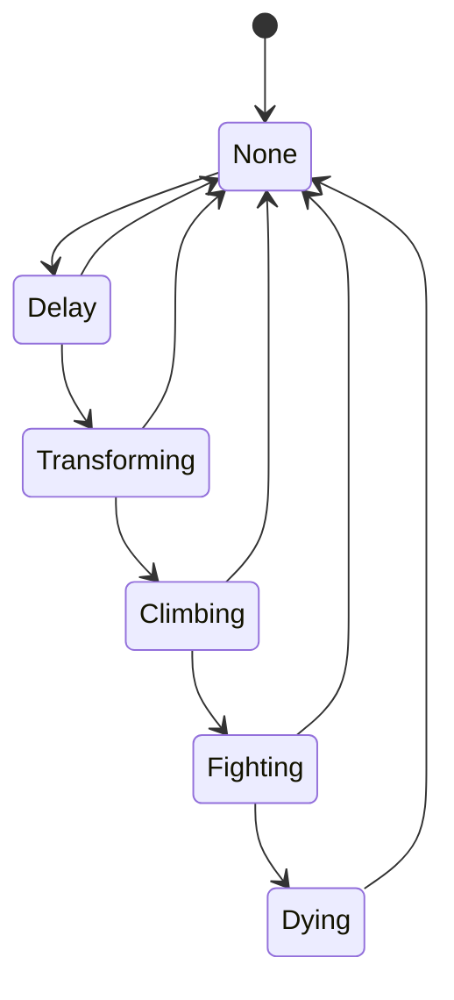

# State machines

Generated from the specs in `godot/ShooterCore/Fsm/StateMachineCatalog.cs` by `StateMachineCatalogTests`. Do not edit by hand: change the spec, then run
`UPDATE_STATE_DOCS=1 dotnet test godot/ShooterCore.Tests --filter StateMachineCatalogTests`.

How to add or change one: see `godot/ShooterCore/Fsm/StateMachine.cs`. `*` means "from any state".

## Demon.Stage

The server's script around the demon brain: the pastor turns, burns into the demon, climbs the wall, fights, dies; anything can end it early.

- **None**: No demon: the Mass is not void or the fight is cleared. Nothing ticks.
- **Delay**: The pastor has turned; his body still lies there for transform_delay_s. A failed spawn (entity cap) clears from here: the doors must still open.
- **Transforming**: The pastor's body is gone, the monks burn, the demon entity exists and cannot be hit (transform_s).
- **Climbing**: Scripted leap from the floor to the first anchor (climb_s); the entity is replicated as Crawling. Not yet hittable.
- **Fighting**: The DemonBrain runs; the demon is a hit target. Ends by its death (a weapon hit) or by a clear.
- **Dying**: The corpse lies for corpse_s; fireballs in the air still fly. Then the server ends the Mass.

