# State machines

Generated from the specs in `godot/ShooterCore/Fsm/StateMachineCatalog.cs` by `StateMachineCatalogTests`. Do not edit by hand: change the spec, then run
`UPDATE_STATE_DOCS=1 dotnet test godot/ShooterCore.Tests --filter StateMachineCatalogTests`.

How to add or change one: see `godot/ShooterCore/Fsm/StateMachine.cs`. `*` means "from any state".

## App.Phase

Boot, menus, loading, a running match; the one value the shooter's entry point and menu shell hang their behaviour on.

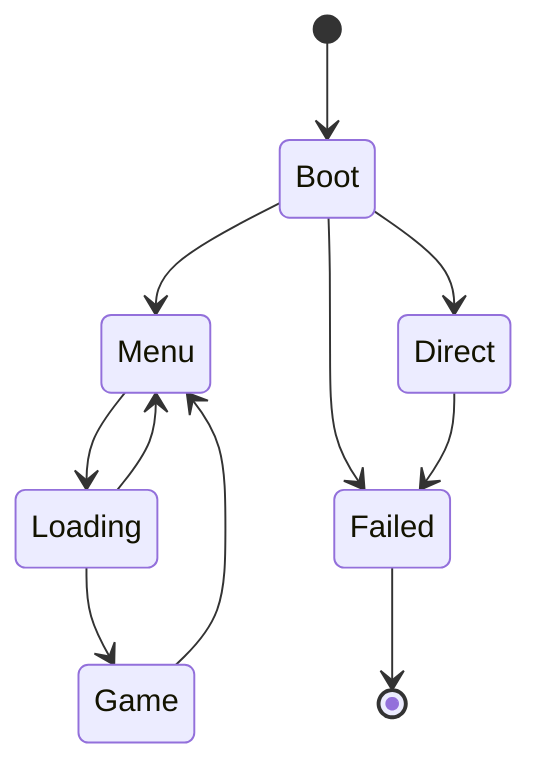

- **Boot**: Menu: client with a display and no smoke or script flags. Direct: server, offline, smoke, bot roles. Failed: startup threw.
- **Menu**: Entered again after a cancelled or failed join (connect screen with the reason) and after leaving or losing a match (toast).
- **Loading**: Left for Game when the server welcomes us; back to Menu when cancelled, failed, or the connection dropped meanwhile.
- **Game**: Left only for Menu: Disconnect from Pause, or the server dropped us.
- **Direct**: No menus; ends with the process, or Failed when loading the data or map threw.
- **Failed**: Terminal: Quit(2) was requested.

## Bigfoot.Act

What the Bigfoot is doing this moment: chasing, winding up or landing one attack, or holding a player; it ends dead.

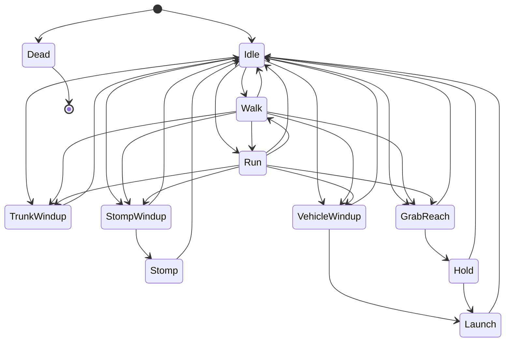

- **Idle**: Standing: nobody in reach, a stop distance reached, or waiting after a wipe. Every ended act comes back here.
- **TrunkWindup**: Log on the shoulder, turning to its target; the log flies when the wind-up ends (back to Idle).
- **StompWindup**: The telegraph; the shockwave starts when it ends. A wipe may cut it short.
- **Stomp**: The shockwave runs (BigfootRules.StompSeconds of pose).
- **VehicleWindup**: The vehicle is lifted overhead; it is thrown when the wind-up ends. A wipe or death drops it.
- **GrabReach**: Reaching for the nearest player on foot; holds them if still in reach, else back to Idle.
- **Hold**: Holds one player in its hand until the hold time runs out (launch) or the player dies or leaves (Idle).
- **Launch**: The short swing after a throw or a launch.
- **Dead**: Reachable from every act (a killing hit, or an admin ending the event).

## Bigfoot.Event

The server's Bigfoot event: none, a living Bigfoot, or the dead one lying out its death clip before it becomes the reward.

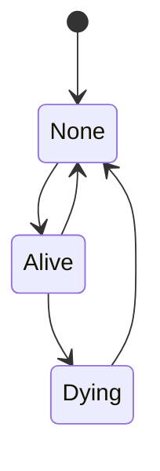

- **Dying**: The event is already won (the book has no running event) but a new Bigfoot may not start until the body is gone.

## Bigfoot.Life

Fighting, healed and waiting after a wipe, or dead.

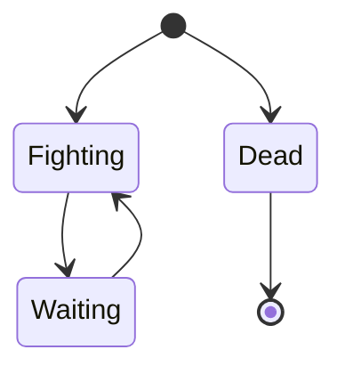

- **Waiting**: Wiped: healed to full, standing where it was, until a living player comes within the wake radius or a shot lands.
- **Dead**: Reachable from Fighting and Waiting (a shot can also kill a waiting one).

## Bigfoot.VehicleThrow

A vehicle the Bigfoot throws: lifted overhead, held until it is thrown (or put down), flying its scripted arc, landed.

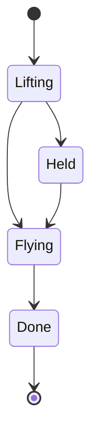

- **Held**: Overhead and still; one nobody throws is put down after a grace time (the Bigfoot died or was wiped with it up there).
- **Flying**: Also the put-down: the arc back to where it stood.

## Citizen.State

What a citizen of the Holy Mass is doing; the replicated state byte.

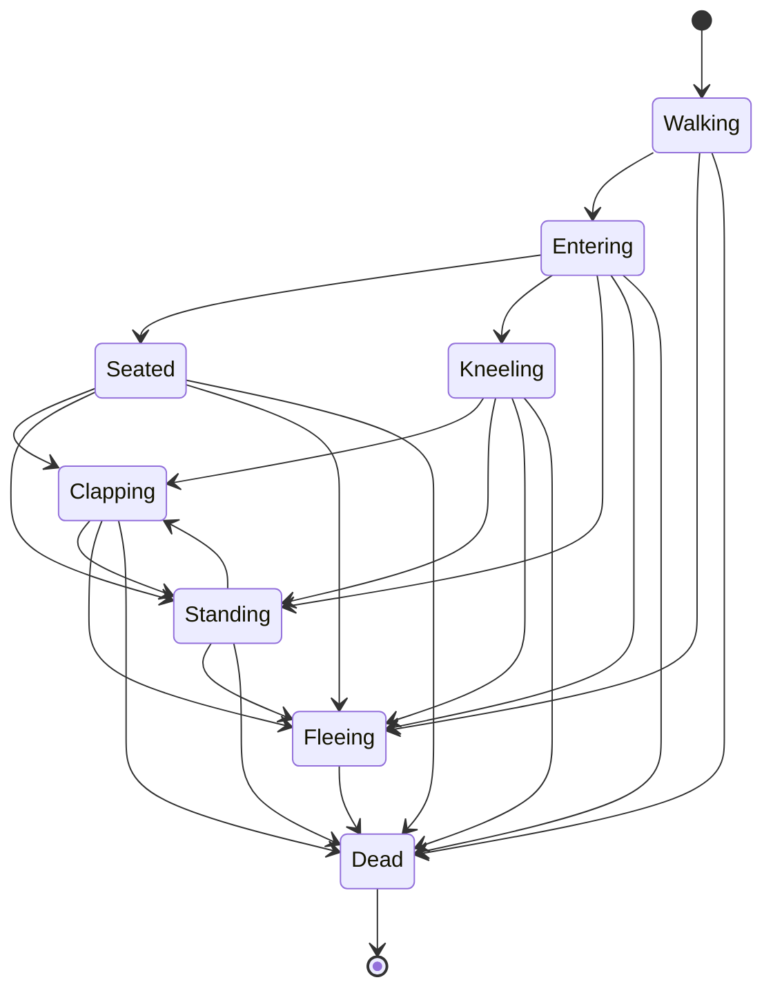

- **Walking**: On the navigation-mesh route from the house to the church door.
- **Entering**: On the scripted route inside the church to the seat.
- **Seated**: In a pew (a citizen; the client plays the sit pose).
- **Dead**: Lies where it fell: a citizen's body is removed after the corpse time, the pastor's and a monk's lie until the event is cleared. Any hit kills in one.
- **Kneeling**: At a standing spot (a citizen).
- **Standing**: The pastor or a monk at their spot, or a citizen on its feet after the Mass.
- **Clapping**: The Mass is done and the body cheers (the pastor flexes).
- **Fleeing**: Sprinting home because the demon came; ends in removal at the spawn point (the entity ends, no state follows).

## Demon.Phase

The demon's mind (Holy Mass): rests on an anchor, and from there roars, leaps, breathes fire, throws a fireball, pounces or crawls; a wipe sends it back to waiting, hits kill it.

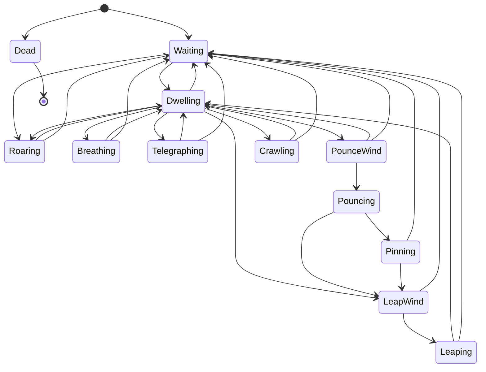

- **Waiting**: Still at its anchor: nobody has come in yet, or a wipe happened and the rearm delay is not over. A wipe in a crawl, leap or pounce lets that finish first (it waits where it gets to).
- **Dwelling**: Resting on an anchor facing its target: picks the next move when the dwell runs out (a due leap, flame and fireball come first).
- **Telegraphing**: The wind-up of a fireball; the telegraph event warns the clients. Back to Dwelling with the dwell it had.
- **Roaring**: Stopped on its anchor, roaring: when it wakes (if the data says so), at a health share, or on the roar clock.
- **LeapWind**: Crouched before a leap; also the crouch of the leap away that ends every pounce.
- **PounceWind**: Crouched and facing its victim, who is marked. Aborts (to Dwelling or Waiting) when the victim is gone.
- **Pouncing**: A homing arc to the victim's feet. Lands as Pinning, or, when the victim is gone, leaps away (LeapWind).
- **Pinning**: Standing over the pinned victim for the pin time, then leaps away. A wipe here leaves it standing on the floor until the rearm delay is over.
- **Dead**: Hits reached the hits needed. Final: a dead demon ignores hits and steps; Reset starts a new one.

## Demon.Pounce

The victim of a pounce: marked in the crouch (Wind), held on landing (Pinned), then let go as Released after the pin or Aborted when they leave or die, or the demon dies or is wiped.

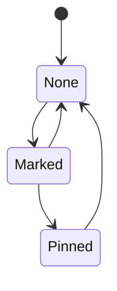

- **None**: Nobody marked. Every way back here sets the pounce cooldown and remembers the victim (never the same one twice while another qualifies).
- **Marked**: The victim is marked from the crouch to the landing; the host holds them back from health changes. Gone before the landing: Aborted, the demon finishes its leap with nobody pinned.
- **Pinned**: Lying flat on the floor under the demon. Pin time over: Released (the host sets their health). Gone, or the demon dies: Aborted.

## Demon.Stage

The server's script around the demon brain: the pastor turns, burns into the demon, climbs the wall, fights, dies; anything can end it early.

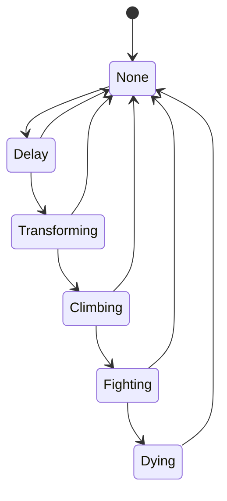

- **None**: No demon: the Mass is not void or the fight is cleared. Nothing ticks.
- **Delay**: The pastor has turned; his body still lies there for transform_delay_s. A failed spawn (entity cap) clears from here: the doors must still open.
- **Transforming**: The pastor's body is gone, the monks burn, the demon entity exists and cannot be hit (transform_s).
- **Climbing**: Scripted leap from the floor to the first anchor (climb_s); the entity is replicated as Crawling. Not yet hittable.
- **Fighting**: The DemonBrain runs; the demon is a hit target. Ends by its death (a weapon hit) or by a clear.
- **Dying**: The corpse lies for corpse_s; fireballs in the air still fly. Then the server ends the Mass.

## Demon.Wake

Whether the demon fights: it sleeps from the start of an event and after a wipe, wakes when a player is inside and the rearm delay is over.

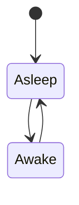

- **Asleep**: Resting phases show as Waiting; the health is back to full and the pounce, flame and leap clocks are cleared.
- **Awake**: Fighting: the hits needed grow with the players inside and never shrink; the fight clock, the roar clock and the leap clock run.

## Event.Run

One run of an event: active, then won (reward given) or despawned (no reward). Both ends are final.

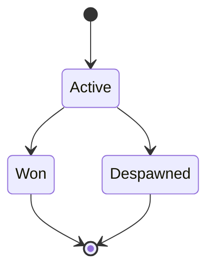

- **Won**: Concluded: the reward is due.
- **Despawned**: Timed out, cancelled or cleared by a round: no reward.

## Mass.Pastor

Whether the pastor stands ready, so the Mass progresses, or a killed one is being replaced.

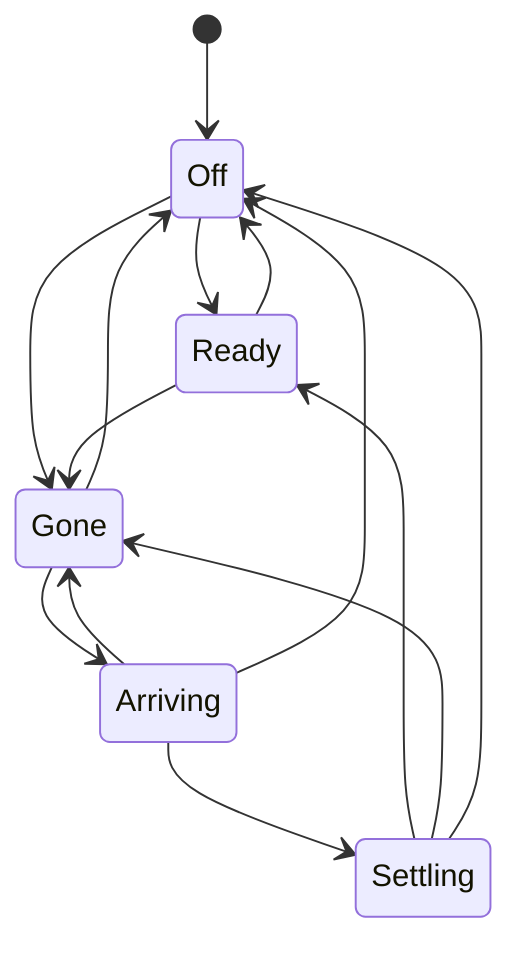

- **Off**: Not tracked: no event, or the Mass is over or void (the pastor no longer pauses anything).
- **Ready**: He stands at his spot and the pause after a kill is over: the chant plays.
- **Gone**: Killed (or the first spawn was refused): a new one walks out after PastorReplaceSeconds; a refused spawn retries every second.
- **Arriving**: The replacement walks from the sacristy door to the pastor's spot.
- **Settling**: He stands at his spot; the Mass resumes after ResumeSeconds.

## Mass.Phase

The Holy Mass event timeline: gather, Mass, done or void.

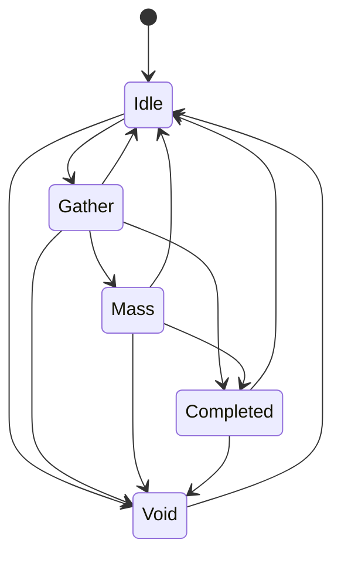

- **Idle**: No event. Start begins the gather; an admin ForceTurn from here starts one that is void at once.
- **Gather**: The bells ring, citizens walk in and sit. Ends when everyone is in place (StartDelaySeconds) or when the gather timer runs out, whichever comes first; Conclude skips to Completed.
- **Mass**: The chant runs; progress counts only while the pastor is ready. Ends at MassSeconds of progress, or by Conclude.
- **Completed**: The blessed are chosen, citizens stand and clap, the pastor flexes. Lingers CompletedSeconds, then the event ends. An admin ForceTurn can still void it.
- **Void**: The pastor turned (third kill or ForceTurn): the demon's cue, citizens sprint home, no blessing. Stays until End or Conclude.

## Mass.Seat

What a player is told about the Holy Mass seats: nothing, a free seat in reach, or sitting.

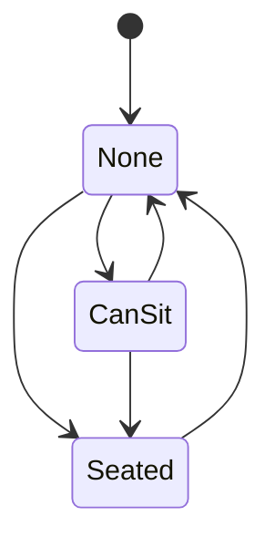

- **None**: No seat in reach, not in the event, or just stood up.
- **CanSit**: A free seat is in reach: the client shows the sit prompt.
- **Seated**: Sitting: the server holds the body, the client does not predict it. Interact or jump stands up; death, a car, the end of the Mass and the blessing end it too.

## Menu.Connect

The connect screen: edit the target, probe it with a visible timeout, show what went wrong.

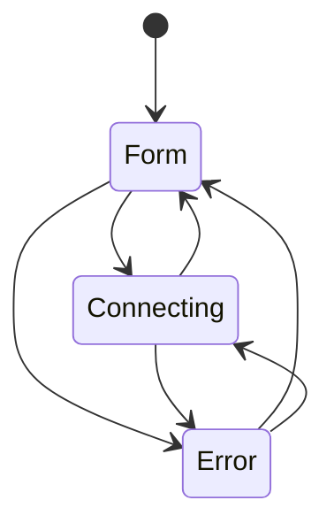

- **Form**: Fields editable. Connect is enabled only for a valid form. A failed join or lost connection reopens the screen as Error instead.
- **Connecting**: Probe running; its sockets are released when this state ends, however it ends. Success hands over to loading (the screen is replaced).
- **Error**: Probe failed (timeout, refused, unresolvable, local socket) or the last join failed. Try again goes straight back to Connecting.

## Pounce.View

The client's view of the demon's pounce: a victim is marked (Wind), pinned flat, then let go; the local victim's camera rises back afterwards.

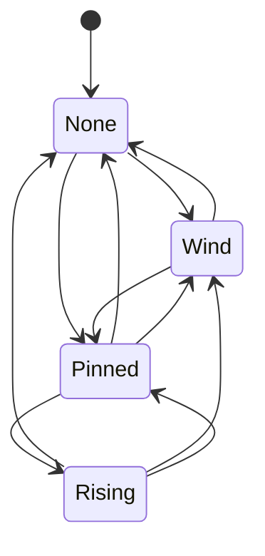

- **None**: Nobody is marked or held (also after the demon is gone).
- **Wind**: A victim is marked: the local victim's look is locked on the demon. A joiner can start here.
- **Pinned**: The victim lies pinned. Locally: the body is the server's (no prediction, no weapon), the camera is on the floor. A joiner can start here.
- **Rising**: The local victim was let go: the camera rises back to standing height while the red fades. Only after a pin of the local player.

