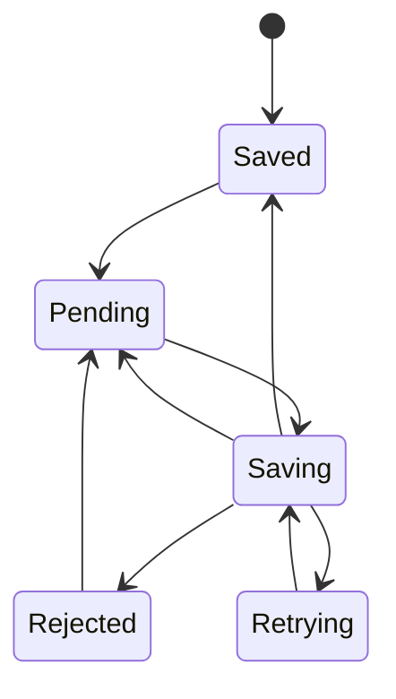

# State machines

Generated from the specs in `godot/ShooterCore/Fsm/StateMachineCatalog.cs` by `StateMachineCatalogTests`. Do not edit by hand: change the spec, then run
`UPDATE_STATE_DOCS=1 dotnet test godot/ShooterCore.Tests --filter StateMachineCatalogTests`.

How to add or change one: see `godot/ShooterCore/Fsm/StateMachine.cs`. `*` means "from any state".

## Loadout.Autosave

One loadout slot's save: debounce, one send on the wire, ack or retry with backoff; an explicit rejection stops the retries.

- **Saved**: Nothing unsent or in flight; no draft.
- **Pending**: Draft waiting for its quiet period (or for the answer to an older send) before it goes out.
- **Saving**: One save for the slot is on the wire. An edit meanwhile only marks the draft newer; it goes after the answer.
- **Retrying**: The send failed (timeout, no connection): resent with backoff. An edit meanwhile keeps the backoff clock and rides the next try.
- **Rejected**: The server refused the draft: shown with its reason, kept, never resent until the next edit or undo.

