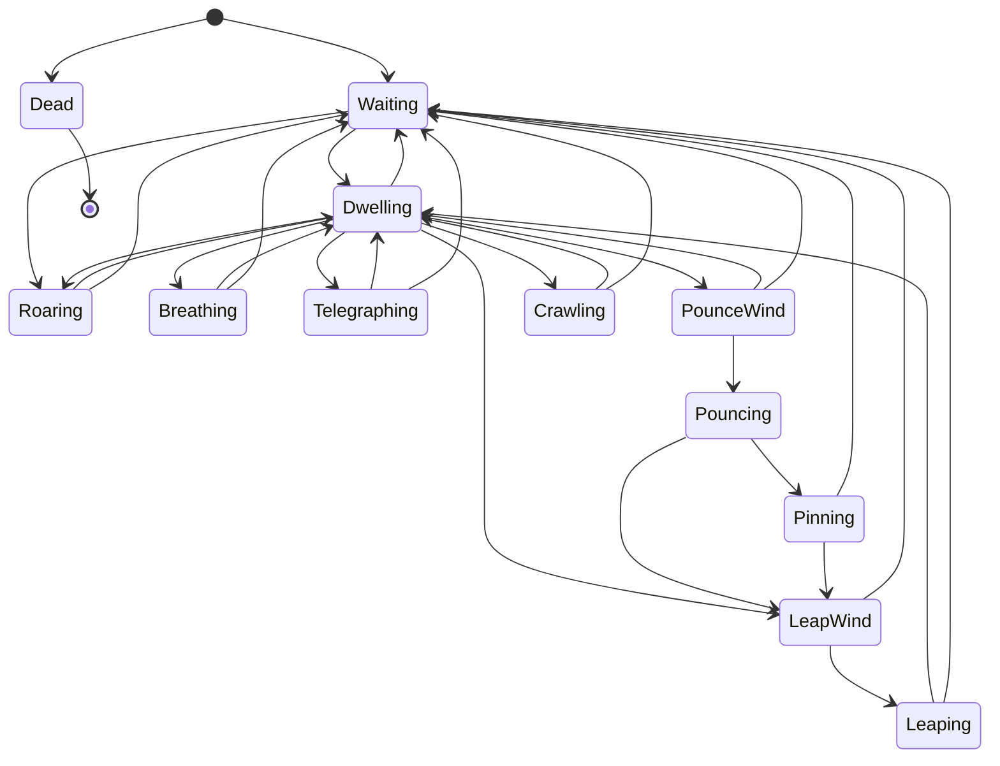
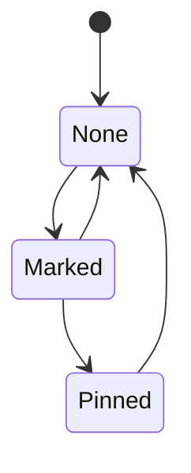
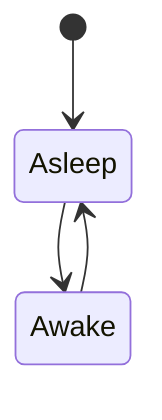

# State machines

Generated from the specs in `godot/ShooterCore/Fsm/StateMachineCatalog.cs` by `StateMachineCatalogTests`. Do not edit by hand: change the spec, then run
`UPDATE_STATE_DOCS=1 dotnet test godot/ShooterCore.Tests --filter StateMachineCatalogTests`.

How to add or change one: see `godot/ShooterCore/Fsm/StateMachine.cs`. `*` means "from any state".

## Demon.Phase

The demon's mind (Holy Mass): rests on an anchor, and from there roars, leaps, breathes fire, throws a fireball, pounces or crawls; a wipe sends it back to waiting, hits kill it.

- **Waiting**: Still at its anchor: nobody has come in yet, or a wipe happened and the rearm delay is not over. A wipe in a crawl, leap or pounce lets that finish first (it waits where it gets to).
- **Dwelling**: Resting on an anchor facing its target: picks the next move when the dwell runs out (a due leap, flame and fireball come first).
- **Telegraphing**: The wind-up of a fireball; the telegraph event warns the clients. Back to Dwelling with the dwell it had.
- **Roaring**: Stopped on its anchor, roaring: when it wakes (if the data says so), at a health share, or on the roar clock.
- **LeapWind**: Crouched before a leap; also the crouch of the leap away that ends every pounce.
- **PounceWind**: Crouched and facing its victim, who is marked. Aborts (to Dwelling or Waiting) when the victim is gone.
- **Pouncing**: A homing arc to the victim's feet. Lands as Pinning, or, when the victim is gone, leaps away (LeapWind).
- **Pinning**: Standing over the pinned victim for the pin time, then leaps away. A wipe here leaves it standing on the floor until the rearm delay is over.
- **Dead**: Hits reached the hits needed. Final: a dead demon ignores hits and steps; Reset starts a new one.

## Demon.Pounce

The victim of a pounce: marked in the crouch (Wind), held on landing (Pinned), then let go as Released after the pin or Aborted when they leave or die, or the demon dies or is wiped.

- **None**: Nobody marked. Every way back here sets the pounce cooldown and remembers the victim (never the same one twice while another qualifies).
- **Marked**: The victim is marked from the crouch to the landing; the host holds them back from health changes. Gone before the landing: Aborted, the demon finishes its leap with nobody pinned.
- **Pinned**: Lying flat on the floor under the demon. Pin time over: Released (the host sets their health). Gone, or the demon dies: Aborted.

## Demon.Wake

Whether the demon fights: it sleeps from the start of an event and after a wipe, wakes when a player is inside and the rearm delay is over.

- **Asleep**: Resting phases show as Waiting; the health is back to full and the pounce, flame and leap clocks are cleared.
- **Awake**: Fighting: the hits needed grow with the players inside and never shrink; the fight clock, the roar clock and the leap clock run.

